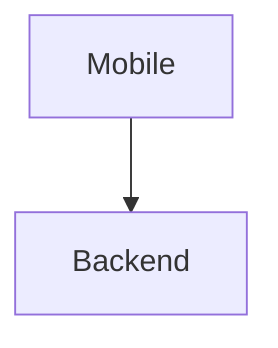

# DUKA-DEV-DOCS — DukaDesk Developer Core Documentation

Docusaurus static site for **developers only**. It explains the **core of the whole
DukaDesk system**: every project in `D:\work\DD`, its folder structure, libraries,
and integrations — with Mermaid visuals, notes, and runnable references.

- **Audience:** backend / frontend / mobile engineers onboarding to DukaDesk.
- **Not for merchants:** merchant how-to lives in `../DUKA-DOCS`.
- **Source of truth for rules:** `../KNOWLEDGE-BASE` (constitution, ADRs, specs).
- **Static output:** `npm run build` → `build/` — host anywhere.

## Quick start

```bash
cd DUKA-DEV-DOCS
npm install
npm start
```

Open http://localhost:3000 — hot reloads as you edit `docs/`.

## Scripts

| Command | What it does |
|---|---|
| `npm start` | Dev server with hot reload |
| `npm run build` | Production build into `build/` (fails on broken links) |
| `npm run serve` | Serve `build/` locally |
| `npm run clear` | Clear Docusaurus cache |
| `npm run swizzle` | Override a theme component |
| `npm run deploy` | Deploy via configured strategy |

## Structure

```
DUKA-DEV-DOCS/
├── docs/
│   ├── intro.md, getting-started.md, system-overview.md, glossary.md
│   ├── projects/       # one page per repo + overview
│   ├── architecture/   # tenancy, auth, api, data-model, runtime, publishing
│   ├── structures/     # folder-by-folder anatomy per project
│   ├── libraries/      # backend / frontend / mobile / shared patterns
│   ├── integrations/   # db, redis, storage, auth, payments, hosting
│   └── workflows/      # local-dev, env, testing, deployment, troubleshooting
├── src/pages/index.js  # landing page
├── src/css/custom.css  # navy #1A1A2E + amber #F4A026 brand
├── static/img/logo.svg
├── docusaurus.config.js  # mermaid enabled via @docusaurus/theme-mermaid
├── sidebars.js
└── package.json
```

Docs are served from `/` (`routeBasePath: '/'`).

## Writing docs

1. Add `docs/<area>/<page>.md` with front matter (`sidebar_position`, optional `description`).
2. Register it in `sidebars.js` under the right category.
3. Prefer: Mermaid diagram first, then table, then notes. Verify paths against the real repo before writing them down.

### Mermaid

Mermaid is enabled globally (`markdown.mermaid: true` + `theme-mermaid`):

````md

````

Keep diagrams small — one idea per chart. Flowcharts for flows, `erDiagram` for data, `sequenceDiagram` for auth/publish.

### Admonitions

```md
:::note Title
Fact.
:::
:::tip
Recommended path.
:::
:::warning
Easy to break.
:::
:::danger
Do not do this in prod.
:::
```

## Troubleshooting

| Symptom | Fix |
|---|---|
| Port busy | `npm start -- --port 3001` |
| Mermaid not rendering | Check `themes: ['@docusaurus/theme-mermaid']` + `markdown.mermaid: true`, then `npm install` |
| Build fails on broken link | Fix the `to:` / `[...](...)` target — build uses `onBrokenLinks: 'throw'` |
| Stale routes/styles | `npm run clear`, restart |

## License

Copyright © DukaDesk. Internal developer documentation — all rights reserved.
