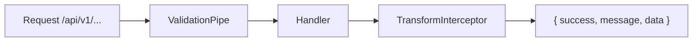
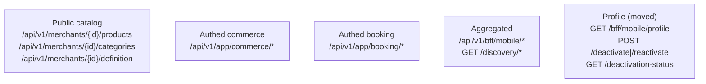
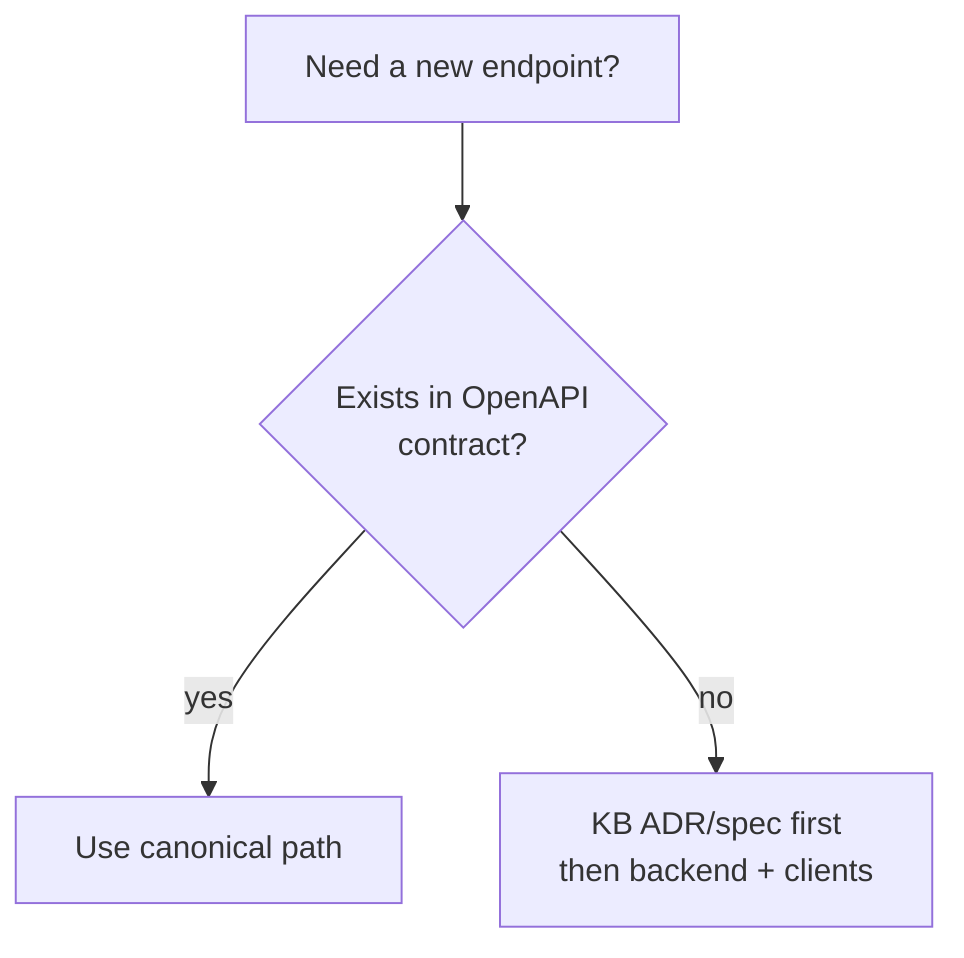

# API conventions

Violating these breaks all three clients at once. Read twice.

## Base rules

| Rule | Value |
|---|---|
| Global prefix | `api` (`main.ts`) |
| Versioning | URI `v1` |
| Swagger | `/api/docs` (`DUKADESK API`, BearerAuth) |
| Envelope | `{ success, message, data }` — every response; clients `unwrap()` it |
| Validation | `whitelist + forbidNonWhitelisted + transform` — unknown fields rejected |
| Limits | JSON 5 MB, 30 s timeout, `maxHeadersCount 50` |

## Canonical routes (live)

:::warning Merchant prefix is `/merchants/{id}`, not `/tenants`
Verified live: `GET /merchants/{id}/products` → 200,
`GET /tenants/{id}/products` → 404. Catalog route for BFF mobile is
`GET /bff/mobile/merchants/{id}/catalog`. Authed merchant routes live under
`/api/v1/app/merchants/*`. See ADR-016 for the full rename map.
:::

## Dead routes — do not call or add

`/api/v1/promotions/ads`, `/api/v1/profile`, `/api/v1/auth/me`,
`/api/v1/cart/*`, `/api/v1/orders/*`, `/api/v1/merchants/{id}/orders|tax-calc`.

:::note Endpoint modules
Mobile keeps one module per domain in `src/services/api/endpoints/*.ts`, each
with its own `unwrap()`. Mirror that granularity when adding backend routes.
:::
