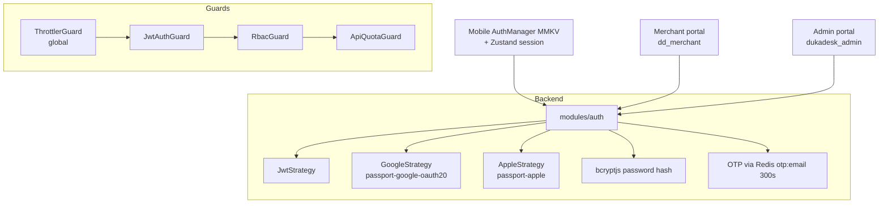
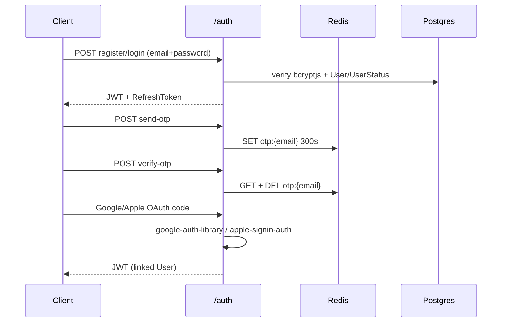

# Auth

## Flows

| Endpoint family | Notes |
|---|---|
| `register/login/refresh` | Email/password (`FEAT-0001` on mobile) |
| `send-otp/verify-otp` | Redis-backed, 5-min TTL |
| `google/apple` | `expo-auth-session` on mobile (lazy-required with `expo-web-browser` to avoid native crash); web/client IDs in `AGENTS.md` |

## Mobile session specifics

- `AuthManager` (MMKV) + Zustand session store; `expo-secure-store` for secrets.
- Google IDs: web `606232078363-08o10lpokt7t9qckgh9kesknmag5a0m9`, android `…0km23v4u50aqn34e9f2urneev7mn9hak`, ios `…0r8h3qlarr9jmaukbngn9qv1e29havmd`.
- 30-min `SessionGate`; guest mode fires `auth:required` → `AuthPromptModal`.

:::danger Token handling
Never log JWTs. Refresh rotates `RefreshToken` rows; `PasswordHistory` blocks
reuse; `Device` tracks sessions. Compromised admin token = rotate `JWT_*` env +
revoke rows, not just redeploy.
:::
