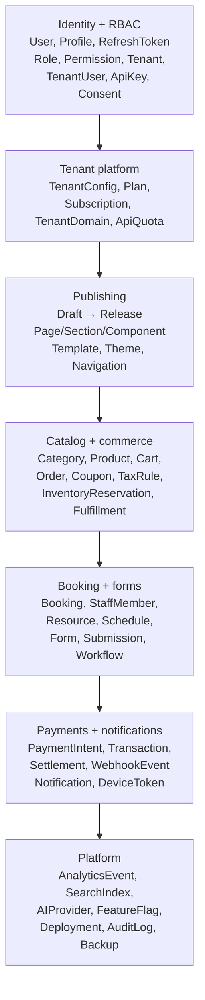
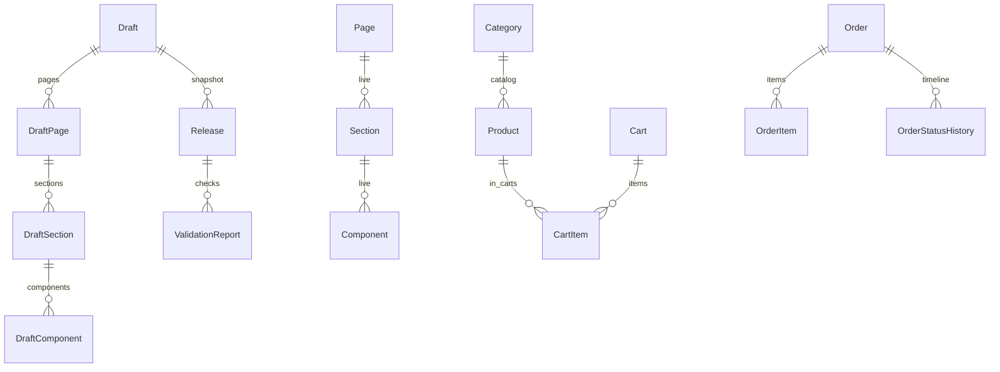

# Data model

`DUKA-BACKEND/prisma/schema.prisma` — Postgres, ~100 models. Groups:

:::note ADR-016: `Tenant*` models are live code names for merchants
No `Merchant` model exists. Read `Tenant` = merchant, `TenantUser` = merchant
membership throughout this page.
:::

## Key chains

| Domain | Core models |
|---|---|
| Identity | `User, Profile, RefreshToken, Device, PasswordHistory, Consent, ConsentScope, ConsentAudit` |
| Ops RBAC | `Role, Permission, RolePermission, UserRole, AdminInvite` |
| Publishing | `Draft, Release, ValidationReport, DraftPage/Section/Component, Page/Section/Component, Template, Navigation, Theme/ThemeVersion` |
| Assets | `Media, AssetFolder/Version/Collection(+Item)/Share, StorageProvider` |
| Commerce | `Category, Product(+Image,Variant), InventoryReservation, Cart(+Item), Order(+Item,StatusHistory), Coupon, Fulfillment, TaxRule` |
| Booking | `Booking, BookingService, StaffMember, BookingResource, Schedule, BookingLocation, CancellationPolicy, BookingReminder, BookingHistory, WaitingListEntry` |
| Payments | `PaymentProvider, TenantPaymentAccount, PaymentIntent, PaymentTransaction, WebhookEvent, Settlement, FinancialEvent` |
| Notify | `Notification, NotificationTemplate/Event/Preference, DeviceToken, DeliveryResult` |
| Integration | `IntegrationConnector, OAuthToken, WebhookOutbox(+Endpoint/EventLog), SyncJob` |

:::tip Migrations
Dev: `npx prisma migrate dev`. Prod/Railway: `migrate deploy` (+ `predeploy`
runs seed). Never hand-edit migrated SQL — add a new migration.
:::
