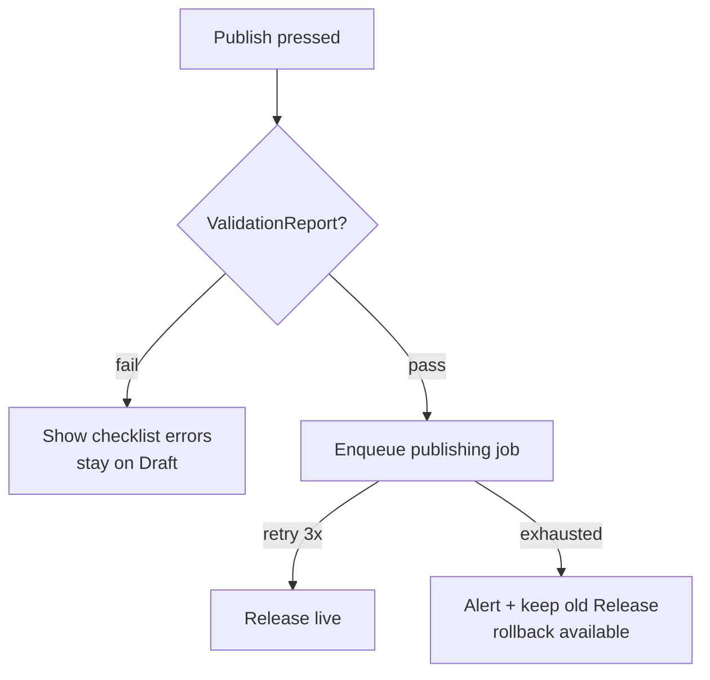

# Publishing pipeline

How a merchant's builder edits become a live consumer app.

```mermaid
flowchart TD
  D[Draft<br/>Draft + DraftPage<br/>DraftSection + DraftComponent] --> V{Validation<br/>ValidationReport}
  V -->|errors| D
  V -->|pass| R[Release<br/>immutable snapshot<br/>+ checksums]
  R --> L[Live tables<br/>Page + Section + Component<br/>ThemeVersion + Navigation]
  L --> M[Manifest<br/>GET /bff/mobile/merchants/{slug}/manifest]
  M --> MO[Mobile PublishedAppShell<br/>ScreenEngine renders]
  R --> RB[Rollback target<br/>previous Release]
```

## Stages

| Stage | Backend owner | Tables / artifacts |
|---|---|---|
| Edit | `builder`, `templates`, `theme` | `Draft*` rows, `ThemeVersion` |
| Validate | `publishing` validators | `ValidationReport` (blocks publish on error) |
| Snapshot | `publishing` | `Release` + `package-index` + `dependency-graph` + `checksums` |
| Serve live | `renderer`, `bff/mobile` | `Page/Section/Component`, `manifest`, `application-package` |
| Update | `shared/releases`, OTA policy | delta OTA, `update-policy`, `rollback`, `compatibility` matrix |
| Observe | queues `publishing, analytics` | async jobs with `attempts 3, backoff 2s` |

## Package 11 reference (bella-italia `publish/` — 32 files)

manifest, application-package, package-index (14 pkgs), dependency-graph
(14 nodes/28 edges), runtime, modules (12), resources (15), assets (20),
startup (12-phase boot), routing (41 screens), navigation (6 tabs, 12 modals),
permissions (6), themes (light/dark/system M3), localization, offline
(cache-then-network + sync + conflicts), cache, analytics, security
(ECDSA-SHA256, AES-256-GCM, tamper detection), deployment, update-policy,
rollback, compatibility (iOS 15–20, Android 8–16, Web 90+), checksums (47 files).

## Failure model



:::warning Releases are immutable
Never mutate a `Release`. Fix forward with a new `Release`; roll back by
pointing the manifest at the previous one.
:::
