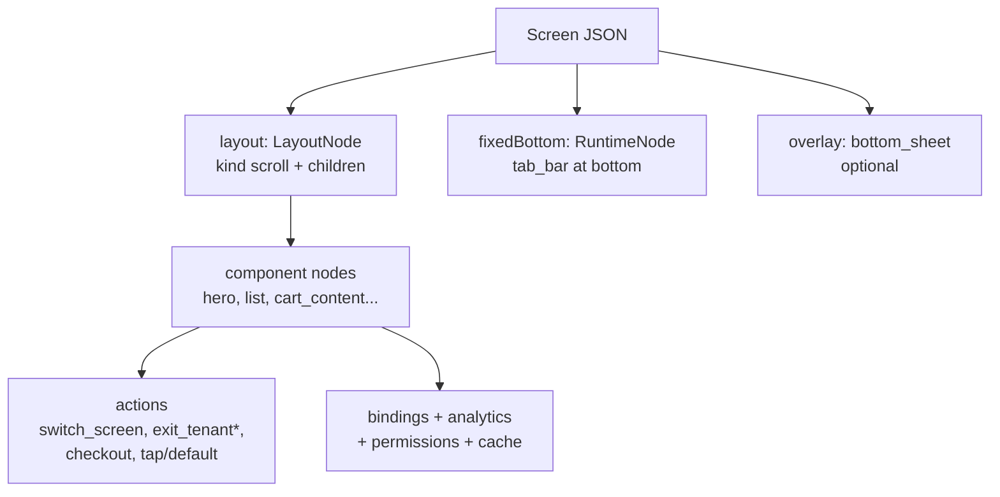
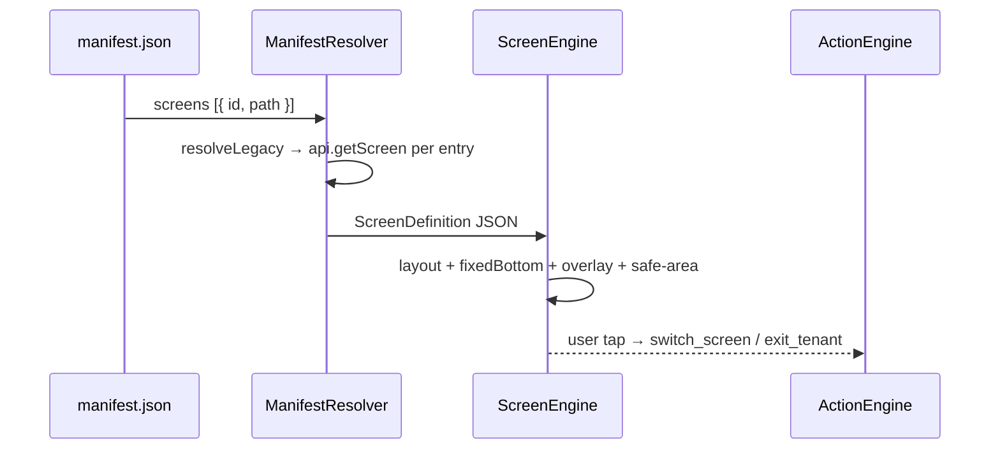

# Runtime SDUI

The mobile app does not hardcode merchant screens. It renders **ScreenDefinition
JSON** (Server-Driven UI) fetched live from the backend manifest.

## Anatomy of a screen



Reference for every component/layout/action/field:
`DukaDesk/docs/examplesTemplate.md`.

:::note `*exit_tenant` is the live action code name
Keep it verbatim in screen JSON (ADR-016). Same for `switch_screen`.
:::

## Screen table (Mama's Kitchen pattern — 11 screens)

| Screen | File | Manifest ID |
|---|---|---|
| Home | `screens/home-screen.json` | `core.home` |
| Menu | `screens/menu-screen.json` | `menu.menu` |
| Cart | `screens/cart-screen.json` | `cart.review` |
| Checkout | `screens/checkout-screen.json` | `checkout.flow` |
| Orders | `screens/orders.history` | `orders.history` |
| Order Detail | `screens/order-detail-screen.json` | `orders.detail` |
| Info | `screens/info-screen.json` | `core.info` |
| Notifications | `screens/notifications-screen.json` | `notifications.list` |
| Support | `screens/support-screen.json` | `support.list` |
| Chat | `screens/chat-screen.json` | `support.chat` |
| Exit | `screens/exit-screen.json` | `core.exit` |

## Rendering flow



## Adding a new merchant screen

```mermaid
flowchart TD
  J[1 Create screens/name-screen.json] --> I[2 Import in mockClient.ts<br/>+ merchant screens dict]
  I --> M[3 Add {id, path} to manifest.json]
  M --> T[4 Validate against examplesTemplate.md]
```

:::note Bella Italia vs Mama's Kitchen
`bella-italia/` = 12 full runtime packages (application → validation, 60+ JSON
each for app/auth/home/menu/cart/orders/reservations/profile-wallet-loyalty/
notifications-settings-support/content/publish/validation). `mamas-kitchen/` =
11 lean SDUI screens. New merchants copy the **Mama's Kitchen pattern**.
:::
