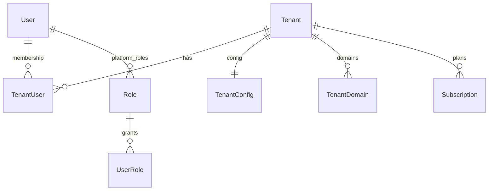
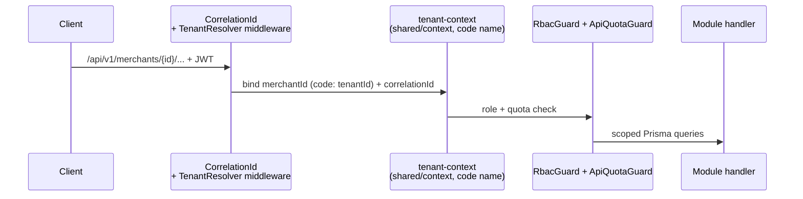

# Tenancy → merchants

One backend serves many merchants. Identity is global; membership is per-merchant.

:::note ADR-016 rename
Product/API language is **merchant**. Code identifiers below (`Tenant`,
`TenantUser`, `tenantId`, `TenantResolver`, tenant-context) are live and stay
verbatim. "Multi-tenant" remains the architecture adjective.
:::

| Table (code name) | Meaning |
|---|---|
| `User` + `Profile` | Global human identity (`UserStatus`, `RefreshToken`, `Device`, `Consent`) |
| `Tenant` | A merchant workspace (`TenantStatus`) |
| `TenantUser` | Membership: user × merchant × `TenantUserRole` |
| `Role` / `Permission` / `RolePermission` / `UserRole` | RBAC graph; `PlatformRole(super_admin/support/operations/finance)` for ops |
| `TenantConfig`, `Plan`, `Subscription`, `TenantDomain`, `ApiQuota` | Config, billing, domains, rate quotas |

## Request resolution

:::note Where it lives
`gateway/middleware`, `common/middleware`, `common/guards`, `shared/context`,
`shared/tenant`, `shared/events/event-bus`. Merchant-scoped commerce uses the
canonical `/merchants/{id}` prefix — see [API conventions](./api-conventions.md).
:::

:::warning Never trust client merchant claims
The merchant comes from the resolver + JWT, not from a body field. Tests that spoof
`tenantId`/`merchantId` in payloads must fail closed.
:::
