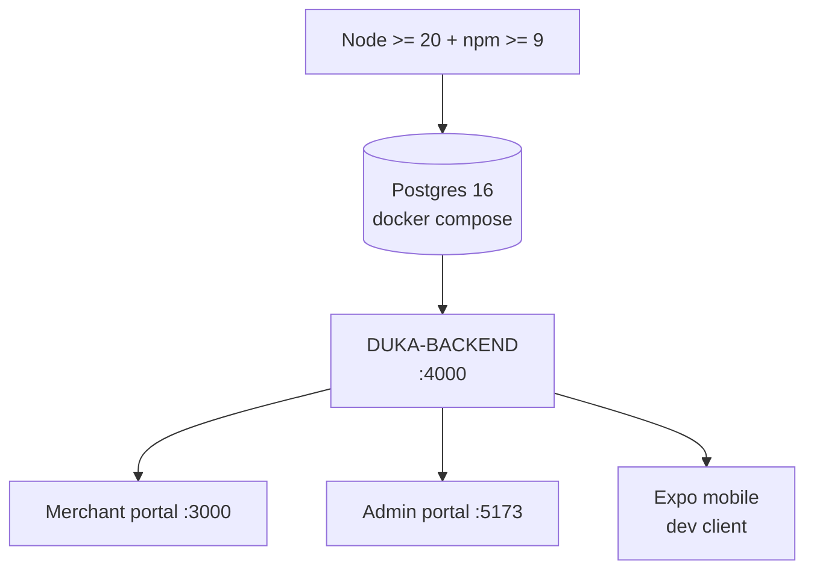

# Getting started

Boot order matters: **database → backend → one client**.



## Prerequisites

| Requirement | Version | Check |
|---|---|---|
| Node.js | ≥ 20 | `node --version` (repo runs 24.x fine) |
| npm | ≥ 9 | `npm --version` |
| Docker | recent | `docker --version` (for Postgres + Redis) |
| Git | recent | `git --version` |
| Expo / EAS | as pinned | only for `DukaDesk` mobile |

:::warning Node version
`DUKA-DOCS` and this site pin `engines: node >= 20`. Backend uses TS 6 + Nest 11 —
do not use Node 16/18.
:::

## 1. Clone / open

All six projects live side by side under `D:\work\DD`:

```
DD/
├── DUKA-BACKEND/
├── DUKA-MERCHANT/dukaDesk/
├── DukaDesk/            # consumer mobile (Expo)
├── DUKA-ADMIN/
├── KNOWLEDGE-BASE/
├── DUKA-DOCS/           # merchant user docs
└── DUKA-DEV-DOCS/       # this site
```

## 2. Backend first

```bash
cd DUKA-BACKEND
cp .env.example .env        # fill DATABASE_URL, REDIS_URL, JWT_*, STORAGE_*, OAuth
docker compose up -d        # Postgres 16 (+ Redis if composed)
npm install
npx prisma generate
npx prisma migrate dev
npm run start:dev           # http://localhost:4000, Swagger at /api/docs
```

:::tip Verify backend
`GET http://localhost:4000/api/v1/health` (see `health` module) and open
`http://localhost:4000/api/docs` for Swagger.
:::

## 3. One client at a time

**Merchant portal:**

```bash
cd DUKA-MERCHANT/dukaDesk
npm install
# set VITE_API_URL=http://localhost:4000/api/v1 in .env
npm run dev   # http://localhost:3000
```

**Admin portal:**

```bash
cd DUKA-ADMIN
cp .env.example .env
npm install
npm run dev   # Vite default port
```

**Mobile (Expo):**

```bash
cd DukaDesk
npm install
npx expo start   # scan QR with dev client; staging uses scripts/run-eas.mjs
```

:::note Backend URL on device
`DukaDesk/src/network/constants.ts` pins the Railway URL for staging. For local
device testing, point it at your LAN IP (not `localhost` — phones can't reach it).
:::

## 4. Docs sites

```bash
cd DUKA-DOCS && npm install && npm start        # merchant guide, :3000
cd DUKA-DEV-DOCS && npm install && npm start   # this site, :3000 (use --port 3001 if clash)
```

## What to read next

- [System overview](./system-overview.md) — full request map.
- [Backend project](./projects/backend.md) — modules + `main.ts`.
- [Env config](./workflows/env-config.md) — every env var that matters.
