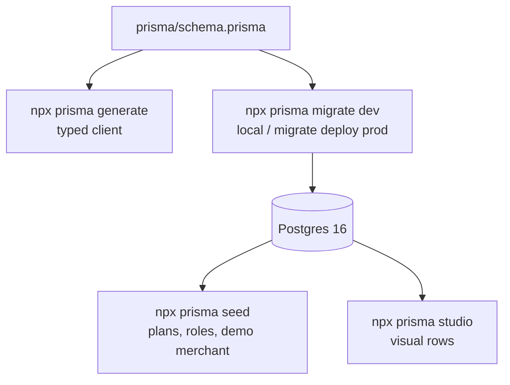

# Database — Postgres + Prisma

| Fact | Value |
|---|---|
| Engine | Postgres 16 (`docker-compose.yml`) |
| ORM | Prisma 6 (`@prisma/client` + `prisma` CLI) |
| Schema | `prisma/schema.prisma` (~100 models) |
| Module | `src/common/prisma.module.ts` / `prisma.service.ts` |
| Seed | `prisma/seed.ts` (`prisma:seed`, `predeploy` runs it) |

## Commands

| Command | When |
|---|---|
| `npx prisma generate` | After schema change / fresh install |
| `npx prisma migrate dev` | Local iteration (creates migration) |
| `npx prisma migrate deploy` | Prod/Railway (applies only) |
| `npm run predeploy` | `migrate deploy && db seed` |
| `npx prisma studio` | Inspect rows visually |

:::warning Migration discipline
Never edit an applied migration. Add a new one. `migrate dev` locally,
`migrate deploy` in prod. A failed deploy with half-applied DDL = restore from
`Backup` (`infrastructure` module) — see [deployment](../workflows/deployment.md).
:::
