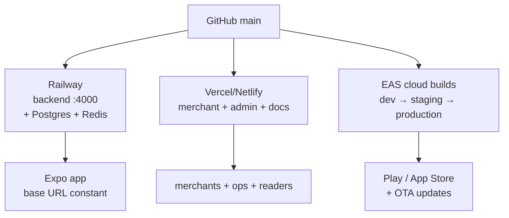

# Hosting

| Project | Host | Config | Build → output |
|---|---|---|---|
| Backend | Railway | `railway.json`, `Dockerfile`, `predeploy` (`migrate deploy && seed`) | `npm run build` → `node dist/main` (`PORT 4000`) |
| Merchant portal | Vercel / Netlify | `dukaDesk` Vite build | `npm run build` → `dist/` |
| Admin portal | Vercel | `vercel.json` | `npm run build` → `dist/` |
| Mobile | EAS | `eas.json`, `app.config.js` | profiles dev/staging/production, auto-submit Android |
| Docs (both) | Vercel / Netlify / Pages / S3 | `package.json` build | `npm run build` → `build/` |

:::note CORS coupling
Backend `CORS_ORIGINS` must include every deployed web origin
(`*.netlify.app`, `*.railway.app`, localhost patterns). A fresh Vercel preview
URL without CORS entry = silent network failure in portal — add it first.
:::
