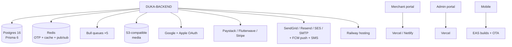

# Integrations overview

| Integration | Detail page | Critical env |
|---|---|---|
| Postgres | [database](./database.md) | `DATABASE_URL` |
| Redis + Bull | [redis-queue](./redis-queue.md) | `REDIS_URL` (or `HOST/PORT`) |
| Object storage | [storage](./storage.md) | `STORAGE_PROVIDER/BUCKET/REGION/ENDPOINT/KEYS` |
| OAuth | [auth-providers](./auth-providers.md) | `GOOGLE_*`, `APPLE_*`, `JWT_*` |
| Payments/notify | [payments-notifications](./payments-notifications.md) | provider keys, `FCM_*`, mail keys |
| Hosting | [hosting](./hosting.md) | `PORT`, `CORS_ORIGINS`, platform tokens |

:::danger Local fallback lies
Redis has an in-memory `Map` fallback and storage falls back to `uploads/`.
Both hide outages locally. Staging must use real Redis + real S3-compatible
storage or queue/OTP/media bugs ship silently.
:::
