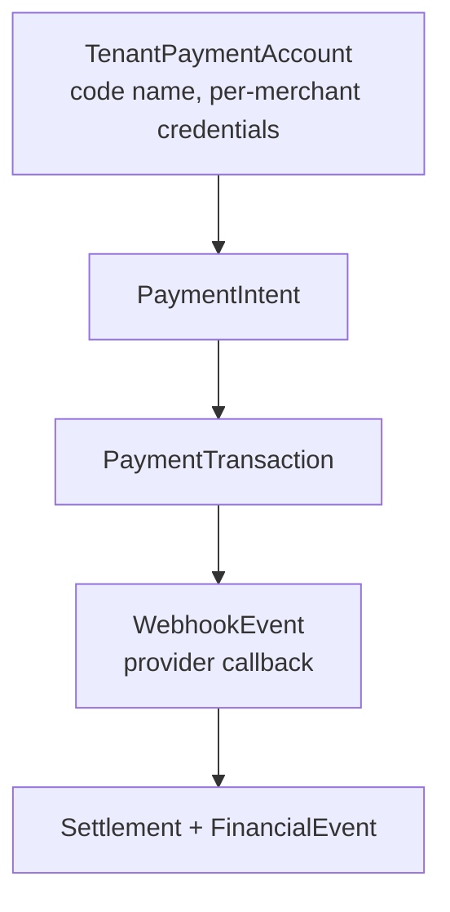
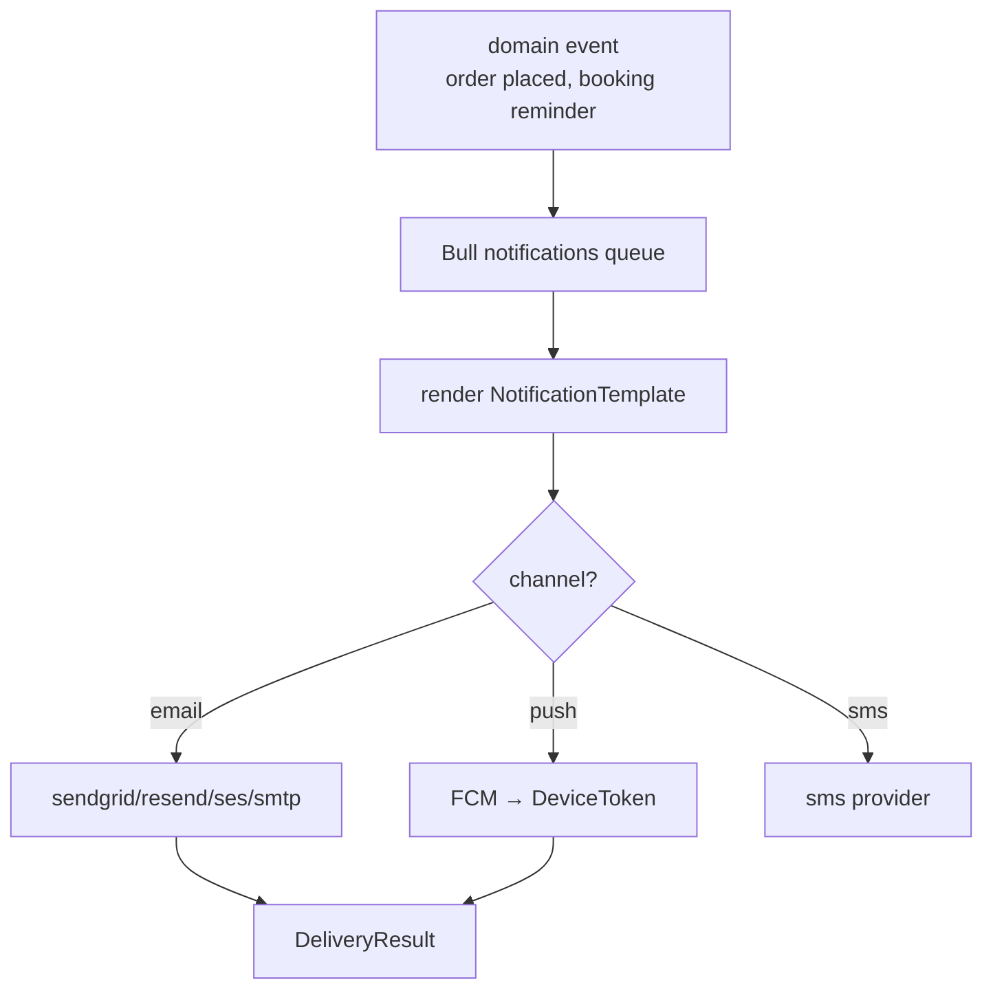

# Payments + notifications

## Payments (`modules/payments`)

Providers: **Paystack / Flutterwave / Stripe** (`PaymentProvider` rows).
`TenantPaymentAccount` (code model name) scopes credentials per merchant — never use platform keys
for merchant charges.

:::danger Webhook idempotency
Providers retry callbacks. `WebhookEvent` dedupes by provider event ID; handlers
must be idempotent (re-entrant `Settlement` writes corrupt payouts).
:::

## Notifications (`modules/notifications`)

| Channel | Providers / tables |
|---|---|
| Email | `log \| sendgrid \| resend \| ses \| smtp` (`NotificationTemplate/Event/Preference`) |
| Push | `FCM` → `DeviceToken` → `DeliveryResult` |
| SMS | `sms` provider |

Booking reminders use `BookingReminder` + `notifications` queue — not cron hacks.
