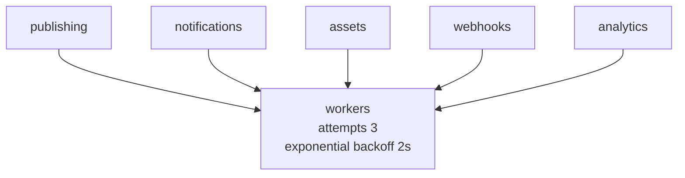

# Redis + queues

| Fact | Value |
|---|---|
| Client | `ioredis` (`src/common/redis/redis.service.ts`) |
| Env | `REDIS_URL` or `REDIS_HOST/PORT` |
| Local fallback | In-memory `Map` with TTL (hides outages — see warning) |
| Queues | `@nestjs/bull` + `bull` (`src/shared/queue/queue.module.ts`) |

## What Redis does

```mermaid
graph LR
  OTP[OTP otp:{email} 300s] --> RD[(Redis)]
  CACHE[Catalog / manifest cache] --> RD
  PUB[publish event-bus] --> RD
```

API: `get / set(key, val, ttl) / del / publish`.

## The 5 Bull queues



| Queue | Typical jobs |
|---|---|
| `publishing` | Release snapshots, manifest rebuilds |
| `notifications` | Email/push fan-out |
| `assets` | Image optimize/register |
| `webhooks` | `WebhookOutbox` delivery + retries |
| `analytics` | Event ingestion |

:::danger Local Map fallback
Without `REDIS_URL`, OTPs and queue backplane silently run in-process. Always
set a real Redis for staging/integration tests, or "works locally, fails in
Railway" is guaranteed.
:::
