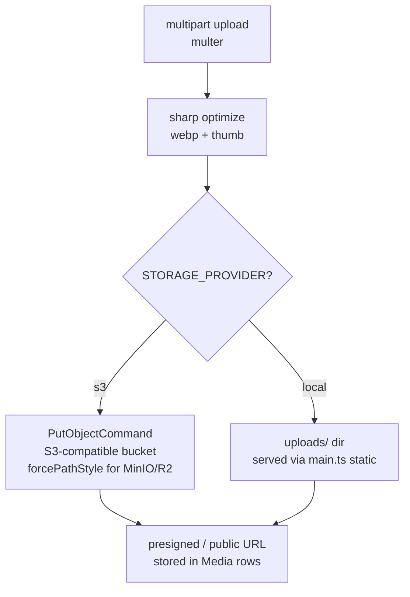

# Storage — S3 + local fallback

| Fact | Value |
|---|---|
| Service | `src/modules/media/storage.service.ts` |
| SDK | `@aws-sdk/client-s3` + `s3-request-presigner` |
| Upload parse | `multer` |
| Optimize | `sharp` (WebP + thumbnails) |
| Env | `STORAGE_PROVIDER=local\|s3`, `STORAGE_BUCKET/REGION/ENDPOINT/ACCESS_KEY/SECRET_KEY` |

:::note S3-compatible, not AWS-only
`forcePathStyle` enables MinIO / R2 / any S3 API. `STORAGE_ENDPOINT` points at
the custom endpoint; leave empty for real AWS.
:::

:::warning Local `uploads/` is not a strategy
It exists for offline dev. Prod without S3 env = uploads vanish on redeploy
(ephemeral disk). Staging must mirror prod storage config.
:::
