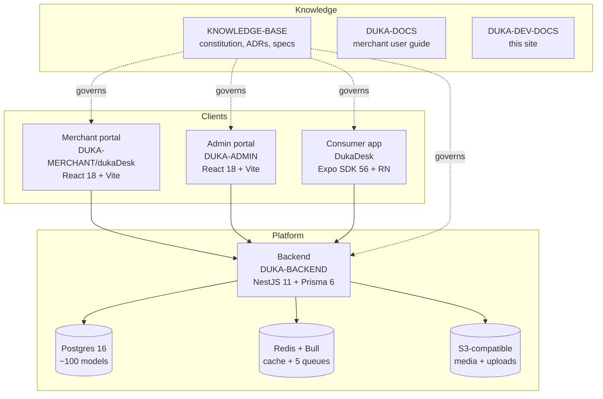
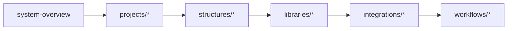

# Intro — developer core docs

This site is **strictly for developers**. It answers one question: **how does the whole
DukaDesk system fit together?**

- Each **project** in `D:\work\DD` — what it is, what stack it uses, where its code lives.
- Each **structure** — folder-by-folder anatomy so you can find anything in 30 seconds.
- Each **library** — why that dependency exists and what breaks if you remove it.
- Each **integration** — Postgres, Redis, S3, Auth, Payments, Hosting — config + env + failure modes.

:::note Where the rules live
This site explains. It does not legislate. The laws are in
`KNOWLEDGE-BASE` (constitution → ADRs → specs), notably
**ADR-016**: product/API language is **merchant / merchant app**, while code
identifiers (`Tenant` model, `tenantId`, `TenantResolver`, `tenantStore`,
`exit_tenant`) stay verbatim. If this site and the KB disagree,
**the KB wins** — then file a fix for this site.
:::

## The system in 60 seconds

| Project | Folder | Stack | Talks to |
|---|---|---|---|
| Backend | `DUKA-BACKEND` | NestJS 11, Prisma 6, Postgres, Redis/Bull, S3, JWT+OAuth | All clients, DB, Redis, S3 |
| Merchant portal | `DUKA-MERCHANT/dukaDesk` | React 18, Vite 8, react-router 7, axios | Backend `/api/v1` |
| Consumer mobile | `DukaDesk` | Expo 56, RN 0.85, expo-router, Zustand+MMKV, React Query | Backend `/api/v1`, `/bff/mobile`, `/discovery` |
| Admin portal | `DUKA-ADMIN` | React 18, Vite 5, react-router 6, Recharts | Backend (platform-admin) |
| Knowledge base | `KNOWLEDGE-BASE` | Markdown OS (no runtime) | Governs all |
| User docs | `DUKA-DOCS` | Docusaurus 3.7 | Merchants (humans) |
| **Dev docs** | `DUKA-DEV-DOCS` | **Docusaurus 3.7 + Mermaid** | Developers (you) |

## How to read this site

1. **[System overview](./system-overview.md)** — monorepo map + request flows. Read first.
2. **[Projects](./projects/overview.md)** — one page per repo: stack, entry point, routing, state.
3. **[Architecture](./architecture/tenancy.md)** — tenancy, auth, API envelope, SDUI runtime, publishing.
4. **[Structures](./structures/backend-structure.md)** — exact folder trees with file responsibilities.
5. **[Libraries](./libraries/overview.md)** — dependency-by-dependency rationale.
6. **[Integrations](./integrations/overview.md)** — external systems, env vars, failure modes.
7. **[Workflows](./workflows/local-dev.md)** — run, test, deploy, debug.

:::tip New to the team? Do this
1. `getting-started` → boot backend + one client.
2. `projects/backend` → understand modules + `main.ts`.
3. `architecture/api-conventions` → learn the `{ success, message, data }` envelope + `/api/v1/merchants/{id}` canonical prefix.
4. `workflows/local-dev` → make one small change end-to-end.
:::

## Conventions used here

- File paths look like `DUKA-BACKEND/src/main.ts` (relative to `D:\work\DD`).
- Routes in `code` (e.g. `/api/v1/merchants/{id}/products`).
- UI names in **bold**.
- Every diagram is Mermaid source — copy it, it renders live.
- `:::warning` = easy to break. `:::danger` = do not do in prod.
