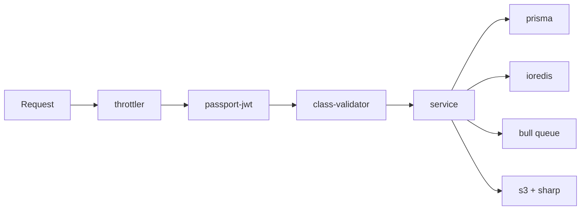

# Backend libraries

| Package | What it does here | Remove it and… |
|---|---|---|
| `@nestjs/common/core/platform-express` | Framework, DI, routing | No API at all |
| `@nestjs/config` | `.env` loading (`DATABASE_URL`, `JWT_*`, …) | Env chaos |
| `@nestjs/swagger` | `/api/docs` contract | No browsable contract |
| `@nestjs/jwt/passport/passport-jwt` | JWT issue/verify | No auth |
| `passport-google-oauth20/passport-apple` + `google-auth-library` + `apple-signin-auth` | OAuth strategies | No social login |
| `bcryptjs` | Password hashing | Plaintext passwords (never) |
| `@nestjs/throttler` | Global rate limits | Brute-force friendly |
| `class-validator/transformer` | DTO validation with `ValidationPipe` | Bad payloads reach DB |
| `@prisma/client` + `prisma` | Typed Postgres access | No data layer |
| `ioredis` | OTP/cache/pub-sub | Auth OTP + cache break |
| `@nestjs/bull` + `bull` | 5 async queues | Publishing/notifications go sync (timeouts) |
| `@aws-sdk/client-s3/s3-request-presigner` | Media uploads + signed URLs | No images |
| `multer` | Multipart parsing | No file upload |
| `sharp` | WebP/thumbnail optimization | Huge images, slow app |
| `nestjs-pino` + `pino(+pretty)` | Structured logs | Blind debugging |
| `uuid` | Idempotency / keys | Collisions |

:::note Dev deps
`@nestjs/cli/schematics/testing`, `swc`, `jest/ts-jest/supertest`,
`typescript 6`, `eslint`, `rimraf`, `ts-node` (seed). Tests: `jest`
`rootDir: src`, `*.spec.ts`.
:::
