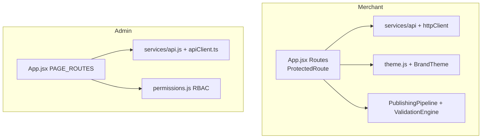

# Frontend libraries

| Package | Merchant (`dukaDesk`) | Admin | Why |
|---|---|---|---|
| `react/react-dom 18.2` | ✅ | ✅ | UI |
| `vite 8.2 / 5.0` + `@vitejs/plugin-react` | ✅ 8.2 | ✅ 5.0 | Dev/build (don't unify blindly) |
| `react-router-dom 7.18 / 6.20` | ✅ 7 | ✅ 6 | Routing (major differs!) |
| `axios 1.x` | ✅ | ❌ (custom `api.js`) | HTTP (merchant only) |
| `recharts 2.12 / 2.10` | ✅ | ✅ | Dashboards/charts |
| `lucide-react 0.383 / 1.39` | ✅ | ✅ | Icons |
| `react-toastify 11` | ✅ | ❌ (`useToast`) | Toasts (merchant) |
| `qrcode` | ✅ | ❌ | QR (merchant, `qr` module backend) |
| `vitest + testing-library` | ✅ | ❌ (Playwright) | Merchant unit tests |
| `playwright 1.40` | ❌ | ✅ | Admin e2e |
| `typescript 5.3` | ❌ (JSX) | ✅ typecheck | Admin types |

:::warning Router majors differ
Merchant is on v7, Admin on v6. APIs (`createBrowserRouter`, guards) are not
drop-in. Upgrade proposals need per-app test runs (`vitest` vs `playwright`).
:::
