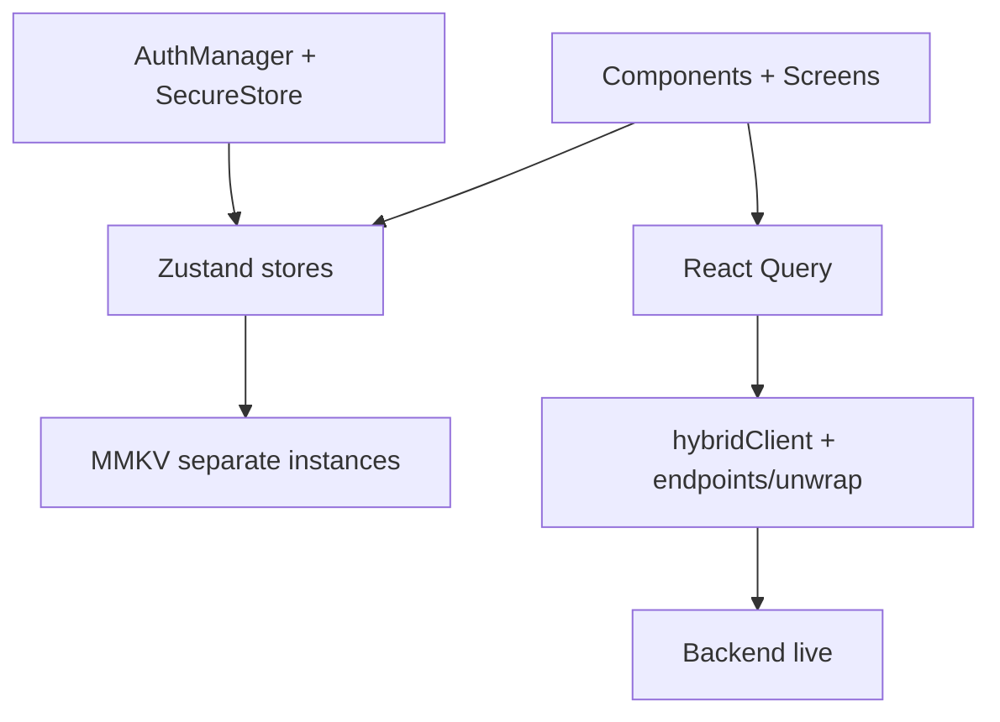

# Mobile libraries

| Package | Purpose |
|---|---|
| `expo ~56.0.12`, `expo-router ~56.2.11` | Runtime + file-based nav (`app/`) |
| `react 19.2.3`, `react-native 0.85.3` | UI (note: React 19, unlike web's 18) |
| `@tanstack/react-query 5` | Server cache (catalog, feeds, orders) |
| `axios` | HTTP under `hybridClient` |
| `zustand 5` | Client stores (session, tenantStore = merchant state, cart, booking, platform, search…) |
| `react-native-mmkv 4.3` | Persisted storage via `storage.ts` factory (+ memory fallback) |
| `expo-secure-store` | Secrets (tokens) |
| `expo-auth-session` + `expo-web-browser` | Google OAuth (lazy-required to avoid native crash) |
| `@react-native-google-signin/google-signin` | Native Google sign-in |
| `expo-notifications/location/camera` | Push, geo, QR/scan (lazy permission helpers in `utils/permissions.ts`) |
| `expo-sqlite` | On-device cache/offline |
| `expo-constants/crypto/updates` | Config, hashing, OTA |
| `reanimated + gesture-handler + screens + safe-area` | Animations, gestures, nav primitives |
| `@expo/vector-icons`, `@expo/ui`, `blur`, `haptics`, `clipboard`, `linking`, `splash-screen`, `status-bar`, `font` | UI kit |
| `google-auth-library` | Token verify (shared with backend) |
| `jest-expo` + `@testing-library/react-native` | Tests |

:::note EAS
`eas.json` profiles: development / staging / production.
`scripts/run-eas.mjs` wraps builds; Android auto-submit on. ProGuard/R8 via
`expo-build-properties`; keep rules for `com.margelo.nitro`, `com.tencent.mmkv`.
:::
