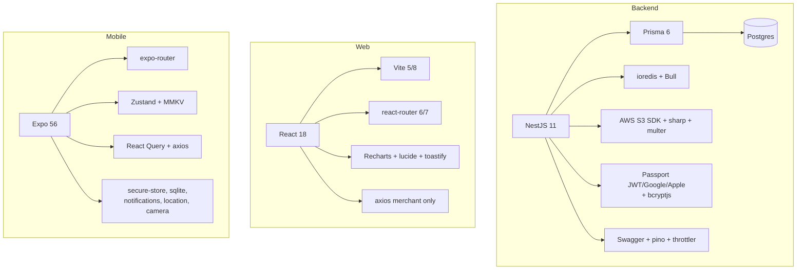

# Libraries overview

| Project | Manager | Lockfile | Install |
|---|---|---|---|
| Backend | npm | `package-lock.json` | `npm install` |
| Merchant | npm | `dukaDesk/package-lock.json` | `npm install` in `dukaDesk/` |
| Mobile | npm | `package-lock.json` | `npx expo install` preferred |
| Admin | npm | `package-lock.json` | `npm install` |
| Docs | npm | `package-lock.json` | `npm install` |

:::warning Version pins that matter
React 18 on both web portals vs React 19 on mobile (Expo 56). `react-router`
6 (admin) vs 7 (merchant). Prisma 6 + Nest 11 on backend. Don't "harmonize"
these without testing each app's build.
:::
