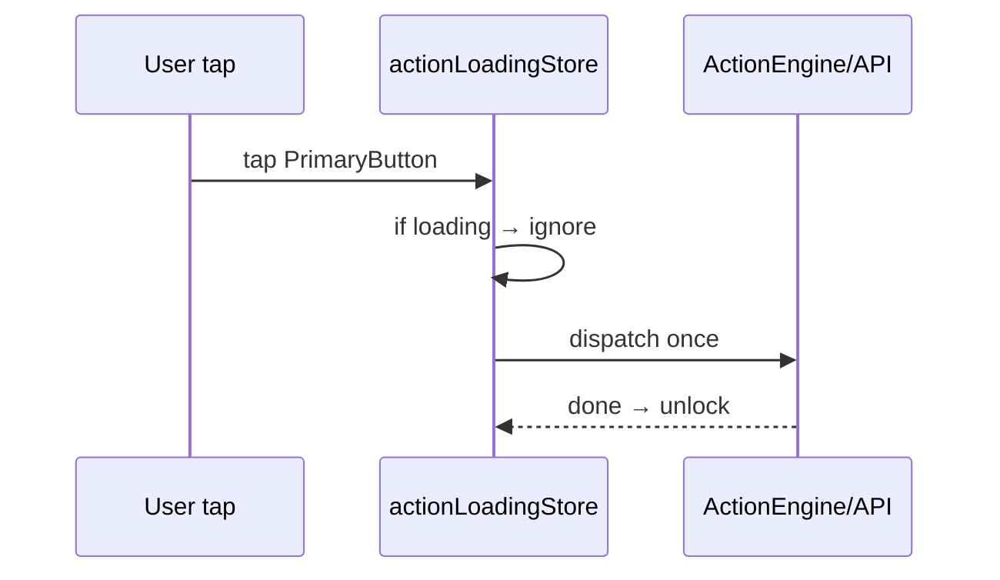
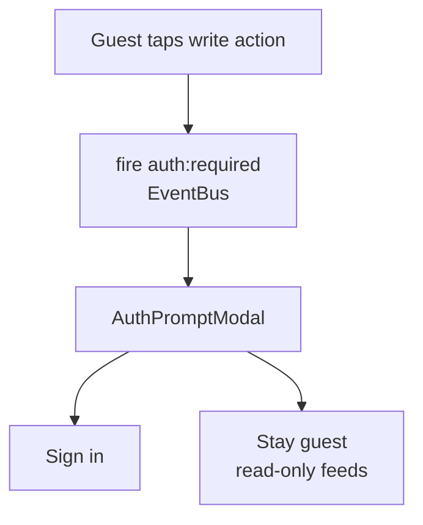
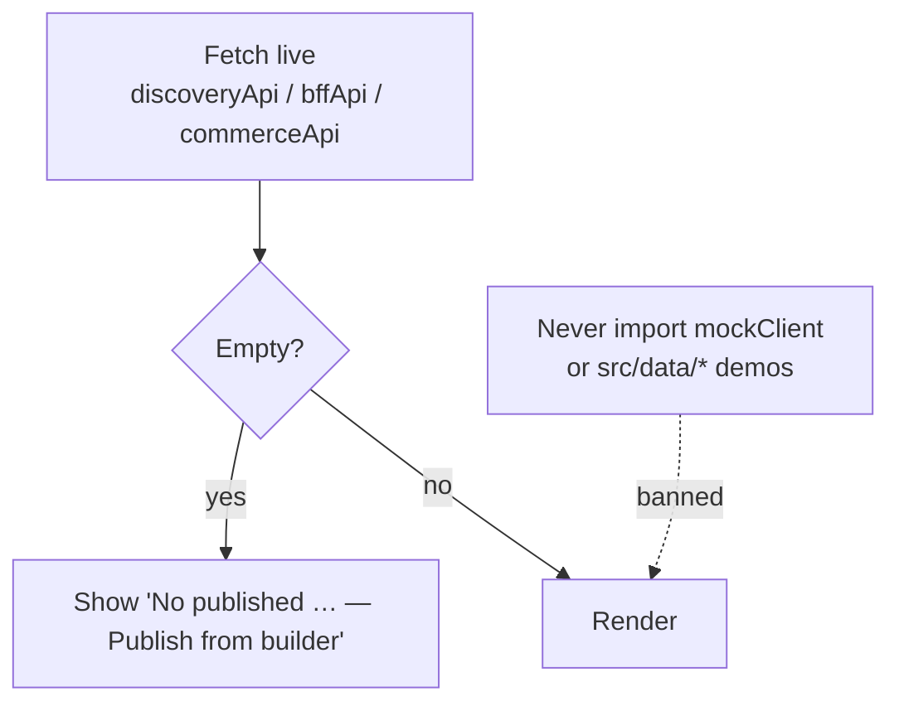

# Shared patterns

Patterns that repeat across backend, web, and mobile. Follow them for new code.

## 1. Envelope + unwrap

```mermaid
flowchart LR
  BE[Backend TransformInterceptor<br/>{ success, message, data }] --> MO[Mobile endpoints/*.ts<br/>unwrap]
  BE --> MP[Merchant httpClient<br/>same shape]
  BE --> AP[Admin unwrapAuth]
```

Backend wraps; every client unwraps. Never invent a second envelope.

## 2. Anti-double-submit (mobile)



`PrimaryButton`/`DynamicButton`/`DynamicCard` are wired to it. New buttons must be too.

## 3. Guest gating (mobile)



Cart/Orders SDUI gated via `CartContentSection` / `OrderHistorySection`.

## 4. No-demo rule (mobile live screens)



## 5. Zero `Alert.alert` (mobile)

Use `ValidationModal` (with `actions` for confirm/cancel). Global rule, no exceptions.

## 6. Lazy + boundaries (web)

Both portals: `React.lazy + Suspense + ErrorBoundary` per page/route.
Admin adds `canAccessPage` RBAC; merchant adds `ProtectedRoute/PublicRoute`.

## 7. Storage factory (mobile)

`src/store/storage.ts` → `createMMKVStorage()` per store (session, tenantStore —
merchant state, booking, platform) with in-memory `Map` fallback. New persisted stores get their
own MMKV instance — never share one.
