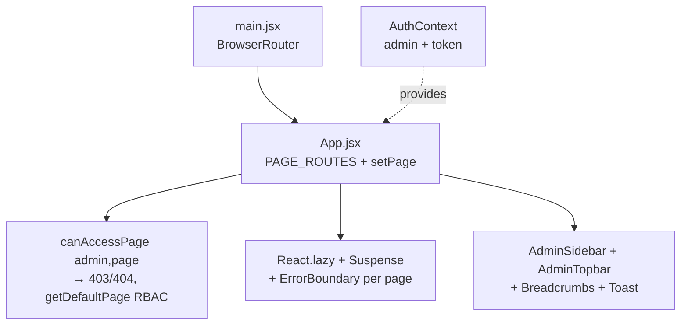

# Admin portal — DUKA-ADMIN

**Role:** operate the platform — merchants, subscriptions, marketplace, audit,
analytics, marketing, infrastructure, pending admins. Not merchant-facing.

| Fact | Value |
|---|---|
| Stack | Vite 5, React 18.2, `react-router-dom` 6.20 |
| Charts/icons | `recharts` 2.10, `lucide-react` 1.39 |
| Network | Custom `services/api.js` + `apiClient.ts` (no axios, no Redux) |
| State | `AuthContext.jsx` (sole global) + local `useState` + `useToast` |
| Tests | Playwright (`playwright.config.ts`) |
| Entry | `src/main.jsx` (`BrowserRouter`) → `src/App.jsx` (state-driven router) |
| Persist | `localStorage: dukadesk_admin` |

## Pages (13 domains)

`Dashboard`, `Merchants`, `Marketplace`, `Audit`, `Subscriptions`, `Analytics`,
`Marketing`, `Infrastructure`, `Settings`, `PendingAdmins`, `Auth/Register`,
`Forbidden`, `NotFound`.

## Services + utils

| File | Purpose |
|---|---|
| `services/api.js`, `apiClient.ts` | Backend calls (platform-admin surface) |
| `services/audit.js` | Audit log reads/writes |
| `services/businessDashboard.js` | Business metrics |
| `services/permissions.js` | `canAccessPage`, `getDefaultPage` RBAC |
| `utils/badgeTones`, `maskEmail`, `unwrapAuth` | Display + auth envelope helpers |
| `hooks/useToast.js` | Toast state |

:::note State philosophy
One context (`AuthContext`), page switched by state synced with
`useLocation/useNavigate`. If you need global server cache here, propose it in
the KB first — don't smuggle in Redux.
:::

## Deploy + checks

- `vercel.json` → Vercel. `npm run typecheck` (`tsc --noEmit`), `npm run lint`,
  `npm test` (Playwright).
- Env: see `.env.example` → mirror in [env config](../workflows/env-config.md).
