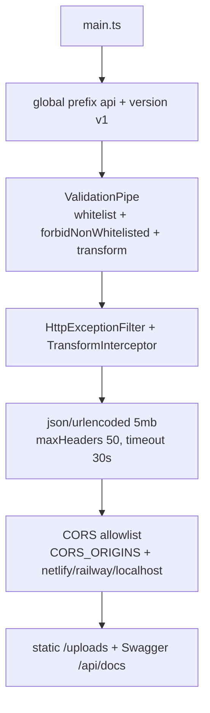
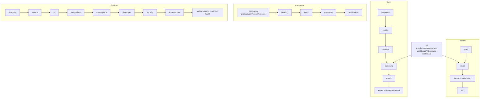
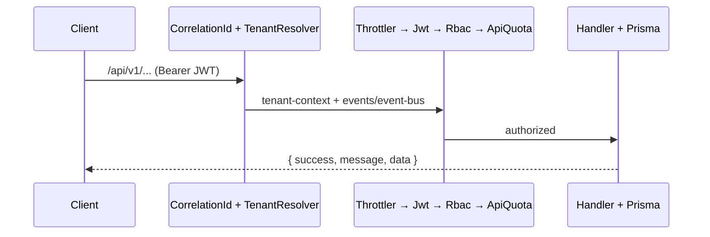

# Backend — DUKA-BACKEND

**Role:** the only stateful service. Auth, RBAC, catalog, cart/orders, booking,
publishing, media, payments, notifications, analytics, BFF aggregators, queues.

| Fact | Value |
|---|---|
| Framework | NestJS 11 (`NestExpressApplication`) |
| ORM / DB | Prisma 6 → Postgres 16 (~100 models) |
| Cache / queues | `ioredis` + `@nestjs/bull` (Bull, 5 queues) |
| Storage | `@aws-sdk/client-s3` (+ local `uploads/` fallback), `sharp`, `multer` |
| Auth | `@nestjs/jwt` + `passport` (`jwt`, `google-oauth20`, `apple`), `google-auth-library`, `apple-signin-auth`, `bcryptjs` |
| Docs | `@nestjs/swagger` at `/api/docs` |
| Entry | `src/main.ts` → `src/app.module.ts` |
| Port | `4000` (`PORT`) |

## Boot (`src/main.ts`)

:::note Conventions enforced at boot
Every DTO is whitelist-validated; unknown fields are rejected
(`forbidNonWhitelisted`). All responses pass through the envelope interceptor —
see [API conventions](../architecture/api-conventions.md).
:::

## Modules (30, wired in `app.module.ts`)

| Group | Modules |
|---|---|
| Merchant core | `auth`, `users`, `iam`, `merchants`, `rbac` |
| Content / build | `templates`, `builder`, `renderer`, `publishing`, `theme`, `media`, `assets-enhanced`, `qr`, `discovery` |
| Commerce | `commerce`, `booking`, `forms`, `payments`, `notifications` |
| Platform | `analytics`, `search`, `ai`, `integrations`, `marketplace`, `developer`, `security`, `infrastructure`, `platform-admin`, `admin`, `health` |
| Aggregation | `bff` (mobile, website, `tenant-dashboard`*, business-dashboard aggregate Users+Releases — *folder code name, serves the merchant dashboard) |
| Cross-cutting | `common` (prisma, guards, strategies, redis, logger), `gateway`, `shared` (context, events, queue, releases, tenant — code names) |

## Request pipeline (guards + middleware)

- Strategies: `JwtStrategy`, `GoogleStrategy`, `AppleStrategy` (`common/strategies`).
- Flows: `register/login/refresh/send-otp/verify-otp/google/apple`.
- OTP cache key: `otp:{email}` TTL 300 s (Redis, in-memory `Map` fallback locally).

## Queues, storage, integrations

| System | Where | Notes |
|---|---|---|
| Queues | `shared/queue/queue.module.ts` | 5 queues: `publishing, notifications, assets, webhooks, analytics`; `attempts 3, exponential backoff 2s` |
| Redis | `common/redis/redis.service.ts` | `REDIS_URL` or `HOST/PORT`; `get/set/del/publish`; local fallback mock |
| S3 | `modules/media/storage.service.ts` | `STORAGE_PROVIDER=local\|s3`, `BUCKET/REGION/ENDPOINT/KEYS`; `forcePathStyle` for MinIO/R2; `sharp` webp/thumb |
| Payments | `modules/payments` | paystack / flutterwave / stripe providers |
| Email/Push/SMS | `modules/notifications` | `log\|sendgrid\|resend\|ses\|smtp` + `push:fcm/sms` |

## Scripts

| Command | Purpose |
|---|---|
| `npm run start:dev` | Watch mode |
| `npm run build` / `npm start` | `rimraf dist && nest build` → `node dist/main` |
| `npx prisma migrate dev` / `migrate deploy` | Dev migrate / prod deploy |
| `npx prisma generate` / `studio` / `prisma:seed` | Client gen / DB UI / seed (`prisma/seed.ts`) |
| `npm run predeploy` | `migrate deploy && db seed` (Railway) |
| `npm test` / `test:e2e` | Jest `src/**/*.spec.ts` + e2e config |

:::warning Do not rename the canonical prefixes
`/merchants/{id}` vs `/tenants`, `/app/commerce/*`, `/app/merchants/*`,
`/bff/mobile/*`, `/discovery/*` are verified against live clients. Changing a prefix breaks
mobile + merchant simultaneously. See [API conventions](../architecture/api-conventions.md).

:::note Residual `tenant` in code
Prisma `Tenant*` models, `shared/tenant`, tenant-context, `create-tenant.dto`,
and one stale `@ApiOperation('Get all tenants (admin)')` string are live and
intentional per ADR-016 — product language is merchant, identifiers stay.
:::
