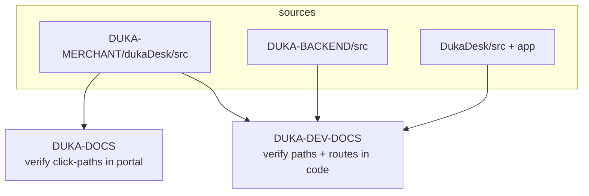
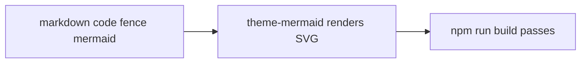

# Docs sites — DUKA-DOCS vs DUKA-DEV-DOCS

Two static sites, two audiences, one brand theme.

| | `DUKA-DOCS` | `DUKA-DEV-DOCS` (this site) |
|---|---|---|
| Audience | Merchants / staff | Developers only |
| Answers | "How do I run my shop?" | "How does the system fit together?" |
| Content | Getting started, daily ops, app builder (10 screens), billing, team | Projects, structures, libraries, integrations, workflows |
| Tech | Docusaurus 3.7 `preset-classic`, React 18, MDX 3 | Same **+ `@docusaurus/theme-mermaid`** |
| Route base | `/` (`routeBasePath: '/'`) | `/` |
| Sidebar | `guide` | `dev` |
| URL | `https://docs.dukadesk.com` | `https://dev-docs.dukadesk.com` |



## Shared anatomy

```
<docs-site>/
├── docs/                  # markdown (this sidebar)
├── src/pages/index.js     # landing (/) — only owner of /
├── src/css/custom.css     # navy #1A1A2E, amber #F4A026 (dark)
├── static/img/logo.svg    # navbar + favicon
├── docusaurus.config.js   # title, url, navbar, footer, mermaid (dev only)
├── sidebars.js            # order + categories
└── package.json           # docusaurus scripts
```

:::warning One owner of `/`
Only one of `src/pages/index.js` and a `slug: /` doc may own `/`. Keep the
landing page in `src/pages/` and start docs at `/intro`.
:::

## Mermaid (dev docs only)

`docusaurus.config.js`:

```js
markdown: { mermaid: true },
themes: ['@docusaurus/theme-mermaid'],
```


