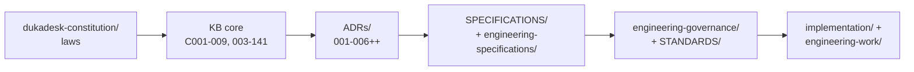
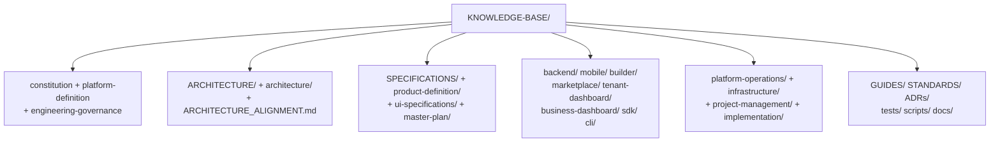

# Knowledge base — KNOWLEDGE-BASE

**Role:** the engineering operating system. Single source of truth for rules.
Code explains *how*; the KB decides *what is allowed*.

## Entry points

| Read | Why |
|---|---|
| `README.md` (v0.1.0, 2026-09-24) | Chain: Constitution → KB → ADRs → Specs → Governance → Implementation |
| `ARCHITECTURE_ALIGNMENT.md` | Pins Constitution/KB/Spec `0.1.0`; tables `KB-C001-009`, `KB-003-141`, `ADR-001-006`, specs (`runtime-engine`, `tenant-model`, `action-system`, `component-system`), `PD-001/002` |
| `ADRs/ADR-016-merchant-app-rename.md` | **Tenant → merchant/app rename**: product/API language map + code-identifier exceptions — read before touching any `tenant` reference |
| `AGENT_BOOT_PROCESS.md` | How agents should boot into this repo |
| `CORE_PRINCIPLES.md`, `PLATFORM_PHILOSOPHY.md` | Non-negotiables |
| `GLOSSARY.md`, `NAMING_STANDARDS.md`, `ENGINEERING_STANDARDS.md` | Language + naming + bars |

## Map of the KB

:::tip Working with the KB
- New pattern? Check `ADRs/` first — `Runtime`, `SDUI`, `Actions`, `EventBus`, `Splash` are already decided (`ADR-001-006`).
- Progress claims? Verify in `PROGRESS.md` / `PROGRESS_REGISTRY.md` — reported
  state: Runtime √ Builder √ Marketplace √ App √ Identity √, Data 16/16 Draft,
  Integration 9/13, Enterprise 6/34.
- Companion doc: `platform-definition/` = *what it is*; `constitution/` = *laws*.
:::
