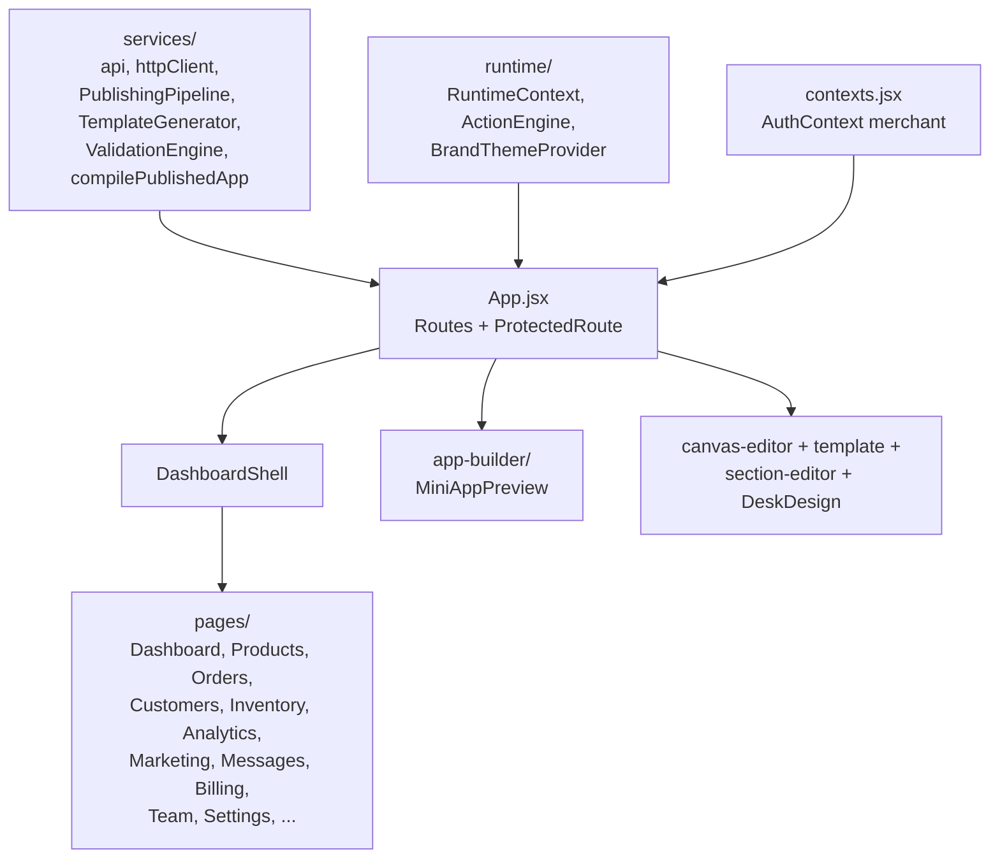
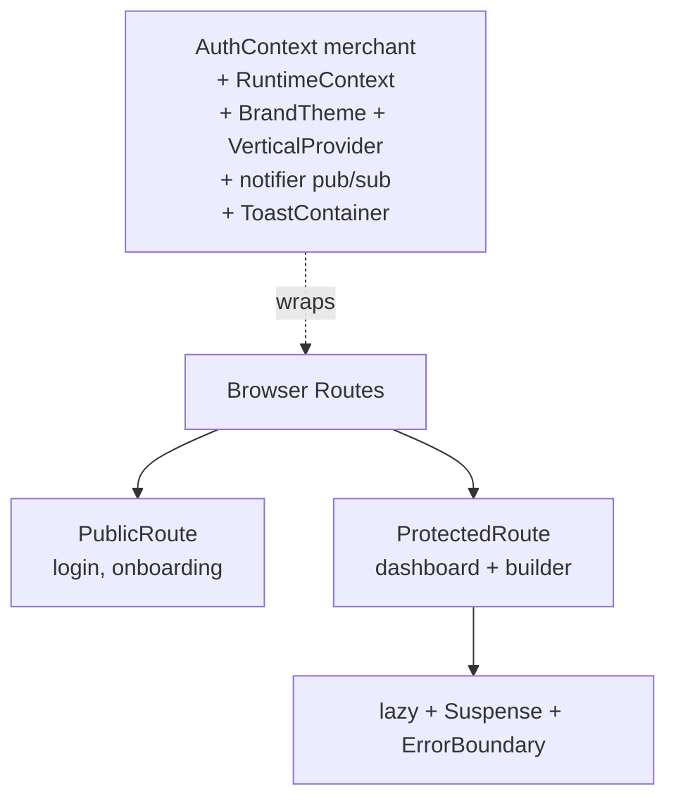
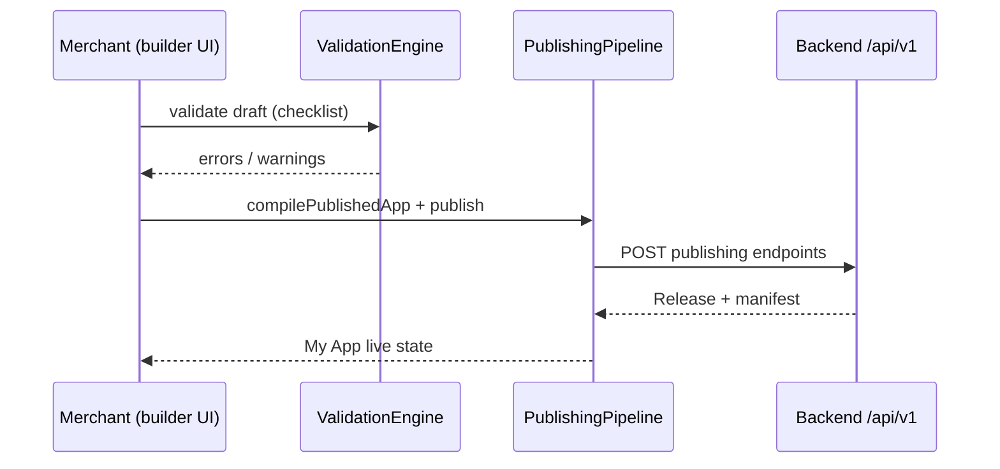

# Merchant portal — DUKA-MERCHANT/dukaDesk

**Role:** where merchants run the business (dashboard, products, orders, billing)
and **build their customer mini-app** (builder → validation → publish).

| Fact | Value |
|---|---|
| App dir | `DUKA-MERCHANT/dukaDesk` (the real app; sibling `stitch_*` are design mocks) |
| Stack | React 18.2, Vite 8.2, `react-router-dom` 7.18, `axios` |
| UI libs | `recharts` 2.12, `lucide-react` 0.383, `react-toastify` 11, `qrcode` |
| Tests | `vitest` + Testing Library + jsdom |
| Entry | `src/App.jsx` (180 lines) → `src/main.jsx` |
| Env | `VITE_API_URL` → backend `/api/v1`; dev `http://localhost:3000` |

## Structure

| Area | Files | Purpose |
|---|---|---|
| Shell | `components/layout/DashboardShell`, `ErrorBoundary` | Authenticated layout + crash boundary |
| Auth | `components/auth/Auth`, `Onboarding` | Signup/login, `localStorage: dd_merchant` |
| Pages | `components/pages/*` + `sector/*` | Business domains (incl. Attendance, Giving, Fees, Appointments, Reservations, Memberships, Tickets, Classes) |
| Builder | `app-builder/MiniAppPreview`, `template/TemplateEditor`, `canvas-editor/CanvasEditor`, `common`, `section-editor` | Visual build + preview |
| Services | `PublishingPipeline`, `TemplateLoader/Generator`, `ValidationEngine`, `builderAgent`, `compilePublishedApp`, `publishedDelivery`, `designCache`, `moduleGate`, `notifier` | Draft → validate → publish to backend |
| Runtime | `RuntimeContext`, `ActionEngine`, `BrandThemeProvider`, `VerticalContext` | Live preview rendering inside portal |

## Routing + state

:::note No Redux
Global state is `AuthContext` + `RuntimeContext` + provider tree + `notifier`
pub/sub. Keep it that way unless a KB ADR says otherwise.
:::

## Publishing path (portal side)

:::tip Builder guides order
The merchant-facing read order (in `DUKA-DOCS`) is add components → screens →
sections/layout → pages/tabs → editing/styling → preview → publish. Keep portal
IA aligned with it.
:::

## Stitch mocks (not shipped)

`sibling stitch_amber_navy_design_system/` holds 5 static mocks (`code.html` +
`screen.png`): school portal, church mini-app, trust system, hair booking,
e-commerce store. Design tokens: Navy `#1a1a2e`, Amber `#F4A026`, Sora + Inter.

:::warning Do not import stitch mocks
They are reference pixels, not components. Real UI lives in `dukaDesk/src`.
:::
