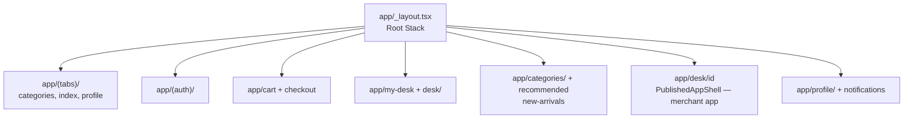
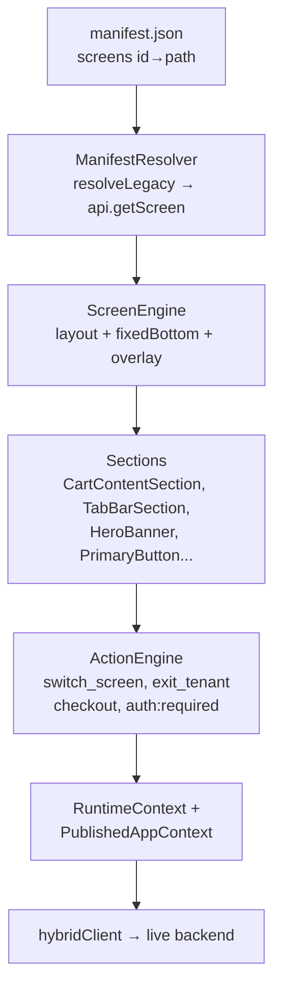
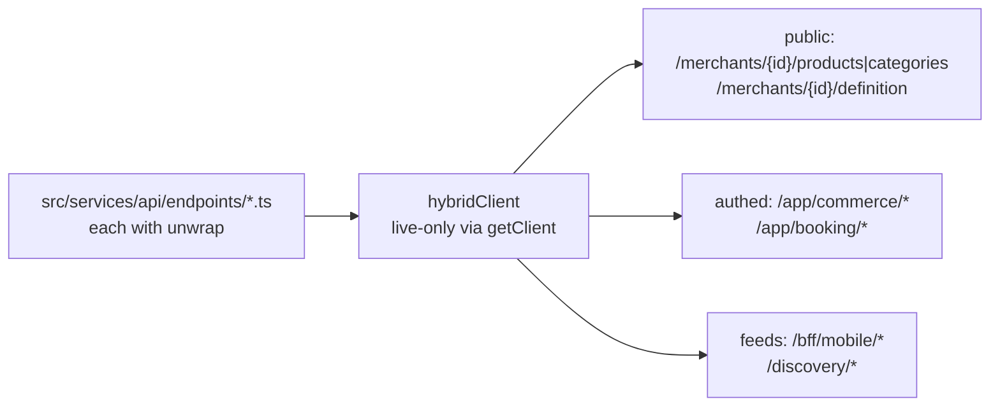
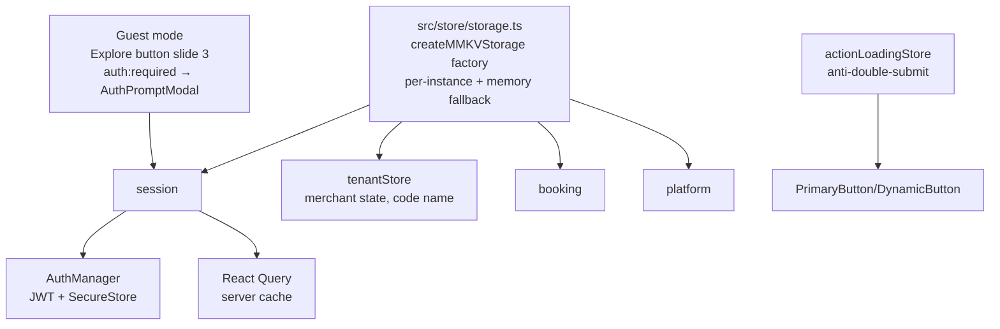

# Mobile app — DukaDesk (Expo)

**Role:** the consumer app. Discovers merchants, renders **published SDUI screens**
live from the backend, handles cart/checkout/orders/booking, auth, guest mode.

| Fact | Value |
|---|---|
| Stack | Expo SDK 56, React 19.2, RN 0.85, `expo-router` 56 (file-based) |
| Navigation | `app/` routes + SDUI `switch_screen` / `exit_tenant` (action code name) via `ActionEngine` + `EventBus` |
| State | Zustand 5 + MMKV 4 persisted stores (`tenantStore.ts` — code name, holds merchant state) + React Query 5 + `AuthManager` (JWT) |
| Network | `axios`, `hybridClient` (live-only), `unwrap()` on `{ success, message, data }` |
| Native | `secure-store`, `sqlite`, `notifications`, `location`, `camera`, `reanimated`, `google-signin` |
| Entry | `app/_layout.tsx` (Root Stack) |
| EAS | project `ea75cd78-…`, owner `dukadesk`, `eas.json` profiles dev/staging/production |

## Routes (`app/`)

`app/app/[tenantId]` still exists on disk but is orphaned — `openPublishedApp.ts`
pushes `/desk/[id]`. `navigation.json`: `backButton: "logo"` (Duka logo, not chevron), 4 tabs
(Home, Cart, Orders, Info). Tab bar is **per-screen JSON** (`fixedBottom` →
`TabBarSection`), not hardcoded — safe-area inset applied by `ScreenEngine`.

## SDUI runtime (the core mental model)

| Piece | File | Notes |
|---|---|---|
| `ScreenEngine` | `src/runtime/ScreenEngine` | Renders `layout{kind:scroll}`, `fixedBottom` bar, `overlay` sheet |
| `ManifestResolver` | `src/runtime/ManifestResolver.ts:89-94` | Maps manifest IDs to `getScreen()` fetches |
| `CartContentSection` | `src/renderers/sections/CartContentSection.tsx` | `cart_content`: guest gate → empty → items + totals + checkout |
| `TabBarSection` | `src/renderers/sections/TabBarSection.tsx` | `tab_bar`: icons above labels, `borderTop` active indicator |
| `HeroBanner` | `src/components/HeroBanner.tsx` | Collapsible, overlay fades, `backButton: logo\|back`, bell → notifications |
| `PrimaryButton` | `src/components/PrimaryButton.tsx` | Falls back `actions.tap` → `actions.default`; anti-double-submit |

:::warning Live-only, no fallback
`GET /merchants/{id}/definition` + `GET /bff/mobile/merchants/{slug}/manifest`
(canonical; `ManifestResolver` still calls the legacy
`/bff/mobile/tenant/{slug}/manifest` path — verify before changing) drive
`PublishedApp`. Empty `screens: []` = show "No published … — Publish from
builder". **No demo fallback.** `mockClient.ts` and `src/data/*` demo files exist
on disk but are **unhooked** (Explore/Categories use `discoveryApi` /
`bffApi.getDiscoveryFeed()` + `commerceApi` only).
:::

## Networking — what calls what

Base URL: `src/network/constants.ts` → `https://duka-backend-production.up.railway.app`.
Profile moved: `GET /profile` 404 → use `GET /bff/mobile/profile`
(+ `/deactivate`, `/reactivate`, `/deactivation-status`, `/app/security/consent`).

:::danger Dead routes — never call
`/promotions/ads`, `/profile`, `/auth/me`, `/cart/*`, `/orders/*`,
`/merchants/{id}/orders|tax-calc`, `/tenants/...` (use `/merchants/...`).
:::

## State + storage

Conventions: zero `Alert.alert` (use `ValidationModal`); `npm run lint` /
`npx tsc --noEmit` before commit; sample merchant mock data lives under
`src/data/runtime/tenants/` (code dir name: `{bella-italia 12 pkgs, mamas-kitchen 11 screens}`) —
see `docs/examplesTemplate.md` for the SDUI field reference.

## Missing backend (hardcoded dummies for now)

`app/profile/addresses.tsx` and `payment-methods.tsx` use dummy data until:

- `GET/POST /api/v1/addresses`, `PUT/DELETE /:id`, `PATCH /:id/default`
- `GET/POST /api/v1/payment-methods`, `DELETE /:id`, `PATCH /:id/default`
