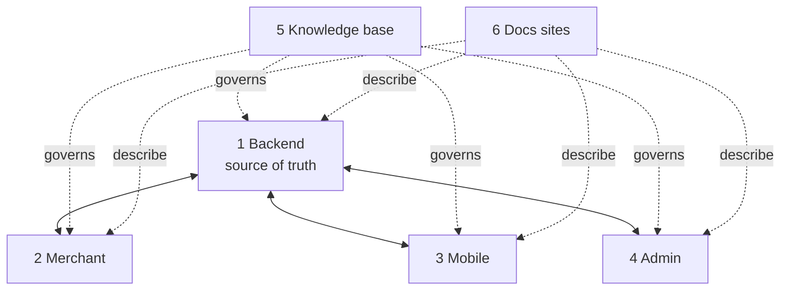

# Projects overview

| # | Project | What it is | Stack | Start here |
|---|---|---|---|---|
| 1 | [Backend](./backend.md) | Multi-merchant API + BFF + queues + publishing | NestJS 11, Prisma 6, Postgres 16, Redis/Bull, S3 | `src/main.ts`, `src/app.module.ts` |
| 2 | [Merchant portal](./merchant-portal.md) | Merchant dashboard + visual app builder | React 18, Vite 8, react-router 7, axios | `dukaDesk/src/App.jsx` |
| 3 | [Mobile app](./mobile-app.md) | Consumer Expo app + SDUI runtime | Expo 56, RN 0.85, expo-router, Zustand+MMKV | `app/_layout.tsx`, `src/runtime/ScreenEngine` |
| 4 | [Admin portal](./admin-portal.md) | Platform ops (merchants, marketplace, audit) | React 18, Vite 5, react-router 6, Recharts | `src/App.jsx`, `src/services/api.js` |
| 5 | [Knowledge base](./knowledge-base.md) | Engineering OS: constitution, ADRs, specs | Markdown | `README.md`, `ARCHITECTURE_ALIGNMENT.md` |
| 6 | [Docs sites](./docs-sites.md) | `DUKA-DOCS` (merchants) + `DUKA-DEV-DOCS` (devs) | Docusaurus 3.7 | `docusaurus.config.js`, `sidebars.js` |

:::tip Choosing where a change goes
- New API behavior → `DUKA-BACKEND/src/modules/*`.
- Merchant UI only → `DUKA-MERCHANT/dukaDesk/src`.
- Consumer rendering → `DukaDesk/src` (+ `app/` routes).
- Platform ops UI → `DUKA-ADMIN/src`.
- Rule / contract change → `KNOWLEDGE-BASE` first (ADR/spec), then code.
:::
