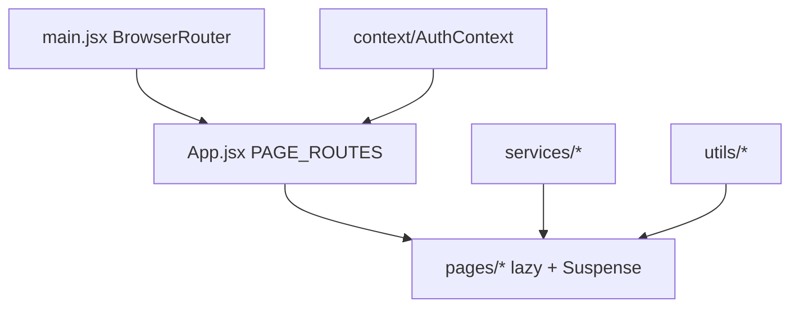

# Admin structure

```
DUKA-ADMIN/
├── src/
│   ├── App.jsx                  # PAGE_ROUTES + setPage + RBAC
│   ├── main.jsx  index.css  App.module.css
│   ├── components/
│   │   ├── Auth/  Layout/AdminSidebar,AdminTopbar
│   │   └── UI/Toast, Breadcrumbs, ErrorBoundary
│   ├── context/AuthContext.jsx  # sole global (admin + token)
│   ├── hooks/useToast.js
│   ├── pages/                   # Dashboard, Merchants, Marketplace, Audit,
│   │                            # Subscriptions, Analytics, Marketing, Infrastructure,
│   │                            # Settings, PendingAdmins, Auth/Register, Forbidden, NotFound
│   ├── services/                # api.js, apiClient.ts, audit.js,
│   │                            # businessDashboard.js, permissions.js
│   └── utils/                   # badgeTones, maskEmail, unwrapAuth, index
├── tests/  scripts/  docs/  knowledge-base/
├── playwright.config.ts  vite.config.ts  vercel.json
└── index.html
```



| Task | Where |
|---|---|
| New ops page | `pages/<X>/` + `PAGE_ROUTES` entry + `canAccessPage` rule in `services/permissions.js` |
| New backend call | `services/api.js` / `apiClient.ts` |
| New role gating | `services/permissions.js` (`getDefaultPage`, `canAccessPage`) |
