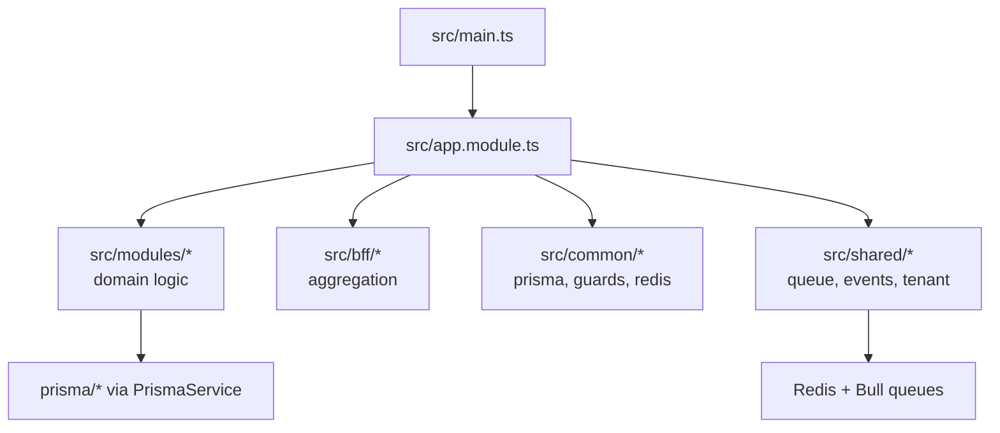

# Backend structure

```
DUKA-BACKEND/
├── src/
│   ├── main.ts                  # boot: prefix, pipes, filters, CORS, Swagger
│   ├── app.module.ts            # wires all 30 modules
│   ├── bff/                     # aggregators: mobile, website, tenant-dashboard* (code name), business-dashboard
│   ├── common/                  # prisma.module/service, bootstrap, decorators, filters,
│   │                            # guards, interceptors, logger, middleware, redis, strategies
│   ├── gateway/                 # gateway.module + middleware (correlation, tenant)
│   ├── modules/                 # 30 domain modules (auth … health)
│   └── shared/                  # compatibility, context, events, queue, releases, tenant (code name)
├── prisma/                      # schema.prisma, seed.ts, migrations/
├── test/                        # e2e (jest-e2e.json), uuid-mock.js
├── docs/ scripts/               # ops docs + scripts
├── docker-compose.yml           # Postgres 16 (+ Redis)
├── Dockerfile + railway.json    # deploy
└── nest-cli.json
```



| Put new code… | Here |
|---|---|
| New domain endpoint | `src/modules/<domain>/` (controller + service + DTOs + spec) |
| Aggregated mobile feed | `src/bff/mobile/` (compose Users+Releases, never raw commerce writes) |
| Guard/strategy/pipe | `src/common/guards|strategies|...` + wire in `app.module.ts` |
| Async work | `src/shared/queue/` (new Bull queue or reuse the 5) |
| Merchant scoping | `src/shared/tenant` + `shared/context` (code names, not ad-hoc headers) |

:::tip Module checklist
Controller (routes) → Service (logic) → DTOs (validated) → Prisma calls →
`*.spec.ts` → Swagger decorators → register in `app.module.ts`.
:::
