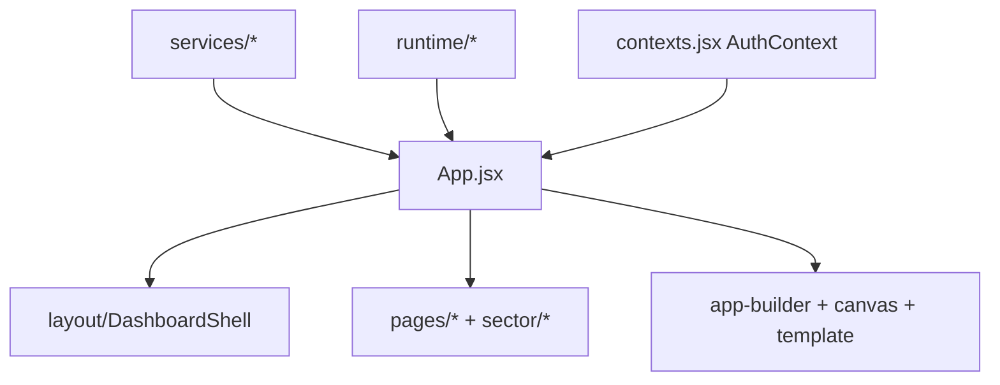

# Merchant structure

```
DUKA-MERCHANT/
├── dukaDesk/src/                # ← the app
│   ├── App.jsx                  # routes + ProtectedRoute (180 lines)
│   ├── main.jsx  theme.js  contexts.jsx  index.css
│   ├── components/
│   │   ├── auth/                # Auth, Onboarding
│   │   ├── layout/              # DashboardShell, ErrorBoundary
│   │   ├── pages/               # Dashboard, Products, Orders, Customers, Inventory,
│   │   │                        # Analytics, Marketing, Messages, Integrations, Billing,
│   │   │                        # Profile, Team, Settings, Notifications, Compliance,
│   │   │                        # DeskDesign, MyApp
│   │   ├── sector/              # Attendance, Giving, Fees, Appointments, Reservations,
│   │   │                        # Memberships, Tickets, Classes
│   │   ├── app-builder/         # MiniAppPreview
│   │   ├── template/            # TemplateEditor
│   │   ├── canvas-editor/       # CanvasEditor
│   │   ├── common/ + section-editor/
│   ├── services/                # api, httpClient, PublishingPipeline, TemplateGenerator/
│   │                            # Loader, ValidationEngine, builderAgent, compilePublishedApp,
│   │                            # publishedDelivery, designCache, moduleGate, notifier
│   ├── runtime/                 # RuntimeContext, ActionEngine, BrandThemeProvider, VerticalContext
│   ├── hooks/ config/ assets/ utils/
└── stitch_amber_navy_design_system/  # static mocks only (code.html + screen.png ×5)
```



| Task | Files |
|---|---|
| New dashboard page | `components/pages/<X>.jsx` + route in `App.jsx` + `DashboardShell` slot |
| New builder capability | `app-builder/` or `canvas-editor/` + `services/ValidationEngine` rule + `PublishingPipeline` step |
| New API call | `services/api.js` / `httpClient` (keep `unwrap` semantics aligned with backend envelope) |
| Theming | `theme.js` + `runtime/BrandThemeProvider` (Navy `#1a1a2e` / Amber `#F4A026`, Sora + Inter) |
