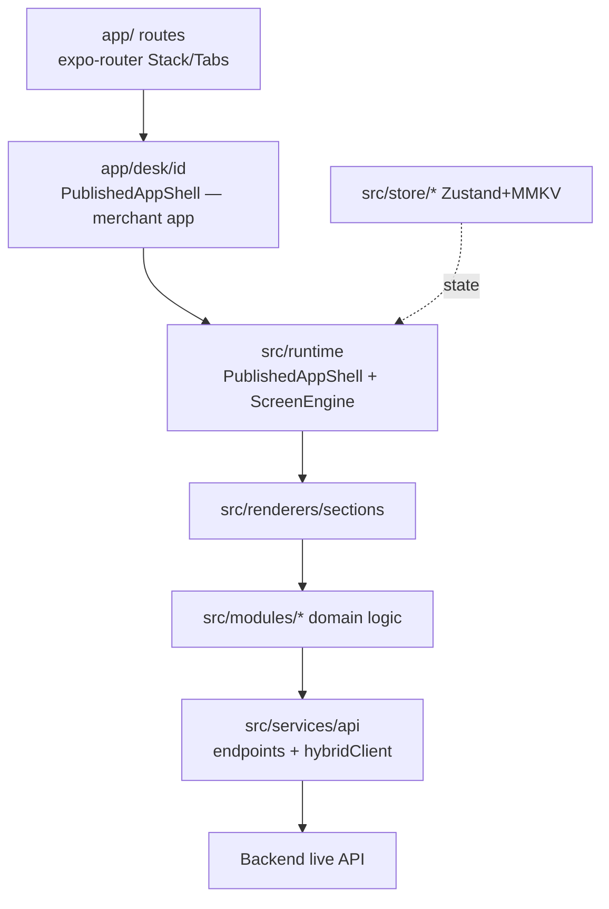

# Mobile structure

```
DukaDesk/
├── app/                         # expo-router (file-based routes)
│   ├── _layout.tsx  index.tsx
│   ├── (tabs)/_layout, categories, index, profile
│   ├── (auth)/  cart  checkout  my-desk  desk/
│   ├── categories/  recommended  new-arrivals
│   ├── app/[tenantId]           # LEGACY orphan (live: desk/[id] → PublishedAppShell)
│   └── profile/  notifications
├── src/
│   ├── runtime/                 # ScreenEngine, ManifestResolver, ThemeEngine,
│   │                            # RuntimeProvider, PublishedAppShell
│   ├── renderers/sections/      # CartContentSection, TabBarSection, ...
│   ├── screens/                 # admin, auth, categories, explore, home, merchant-app,
│   │                            # merchant-chat, messages, profile, saved-apps, session
│   ├── modules/                 # cart, catalog, checkout, booking, orders, delivery,
│   │                            # events, forms, messaging, notifications, promotions, registry
│   ├── services/api/            # endpoints/*.ts (unwrap each), hybridClient (live),
│   │                            # mockClient (unhooked), index
│   ├── store/                   # session, tenantStore (merchant state, code name), cart, booking, platform, search,
│   │                            # settings, actionLoading, storage.ts (MMKV factory)
│   ├── data/runtime/tenants/    # code dir name; sample merchant data: bella-italia (12 pkgs) + mamas-kitchen (11 screens)
│   ├── components/  hooks/  network/  theme/  utils/  validation/  sync/  types/
├── app.config.js  eas.json      # EAS dev/staging/production
└── docs/examplesTemplate.md     # canonical SDUI reference
```



| Task | Where |
|---|---|
| New route | `app/<name>.tsx` + tab/stack entry in `_layout` |
| New SDUI component | `src/renderers/sections/<X>.tsx` + register type + document in `examplesTemplate.md` |
| New API domain | `src/services/api/endpoints/<domain>.ts` with `unwrap()` |
| New persisted state | `src/store/<x>.ts` via `storage.ts` factory (separate MMKV instance) |
:::warning Demo data is unhooked
`src/data/deskCategories.ts`, `nearbyStores.ts`, `promoAds.ts`,
`runtime/tenants/**` (code dir name — sample merchant data), `mockClient.ts` remain on disk but must not be imported by
live screens. Live screens use `discoveryApi` / `bffApi` / `commerceApi` only.
:::
