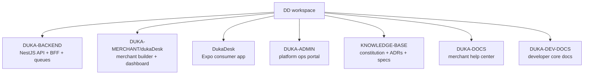
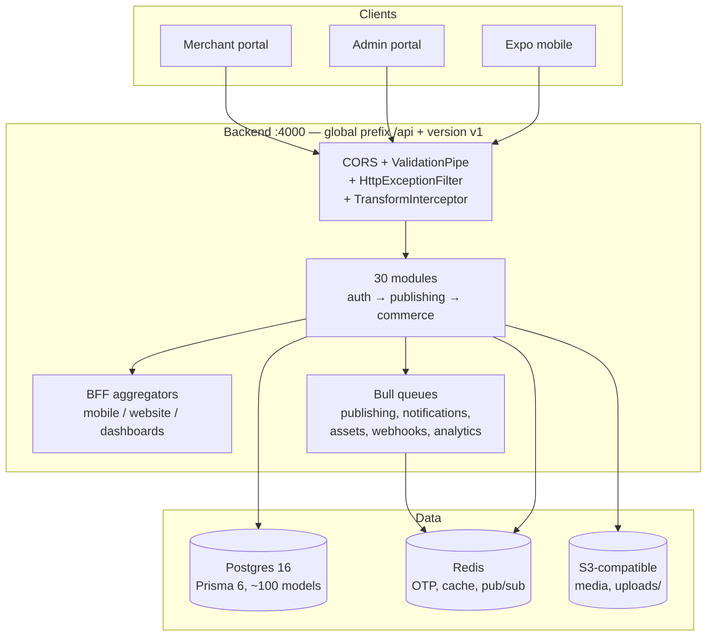
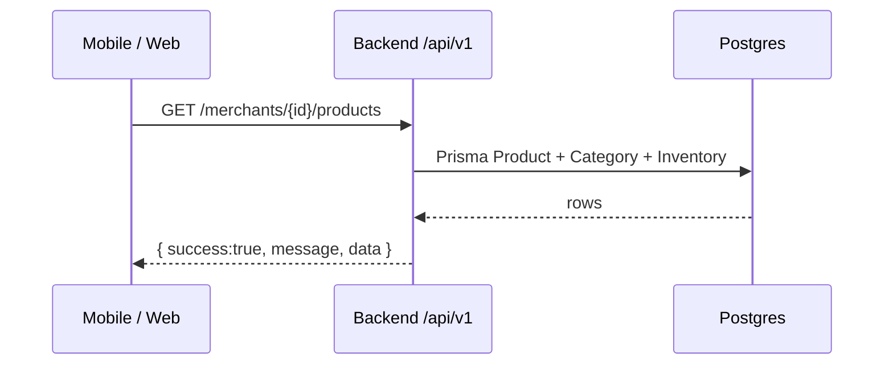
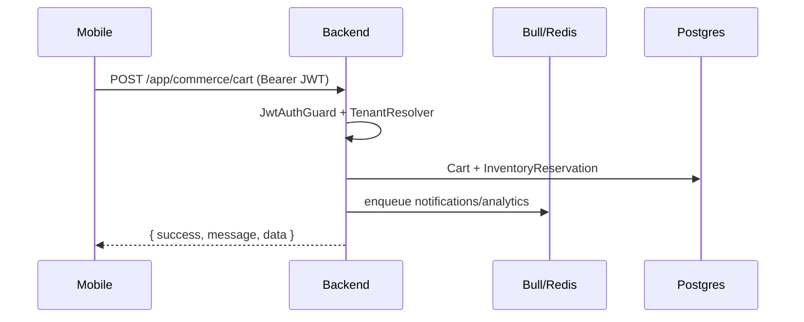
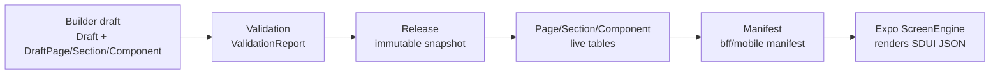
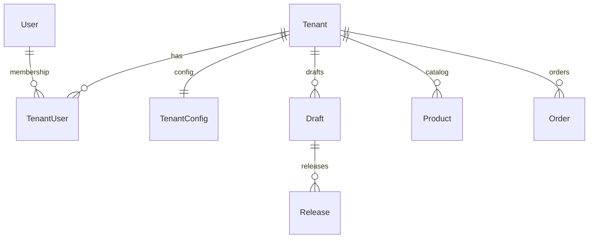

# System overview

DukaDesk is a **multi-merchant commerce platform**: merchants build merchant apps in the
Merchant portal, publish them through the backend pipeline, and consumers use them
inside the Expo mobile app. The Admin portal operates the platform itself.

## Monorepo map



| Concern | Owner | Deploys to |
|---|---|---|
| API, BFF, publishing, billing, auth | `DUKA-BACKEND` (`railway.json`, `Dockerfile`) | Railway |
| Merchant dashboard + app builder | `DUKA-MERCHANT/dukaDesk` | Vercel / Netlify |
| Consumer mobile | `DukaDesk` (`eas.json`) | EAS (dev / staging / production) |
| Platform ops | `DUKA-ADMIN` (`vercel.json`) | Vercel |
| Static docs | `DUKA-DOCS`, `DUKA-DEV-DOCS` | Vercel / Netlify / Pages / S3 |

## Runtime topology



:::note Key `main.ts` facts (`DUKA-BACKEND/src/main.ts`)
Global prefix `api` + URI versioning `v1`. `ValidationPipe{whitelist,
forbidNonWhitelisted, transform}`. JSON limit 5 MB. CORS allowlist +
`*.netlify.app` / `*.railway.app` / localhost. Swagger at `/api/docs`.
Static `/uploads`. Timeout 30 s.
:::

## Canonical request flows

### Public catalog (no auth)



### Authenticated commerce



:::warning Canonical prefix
Commerce/booking/tax/categories use `/api/v1/merchants/{id}` — **not**
`/tenants`. Authenticated commerce/cart/order/tax live under
`/api/v1/app/commerce/*`, booking detail under `/api/v1/app/booking/*`.
BFF mobile under `/api/v1/bff/mobile/*`, discovery under `/discovery/*`.
Do not invent `/cart/*`, `/orders/*`, `/profile`, or `/merchants/{id}/orders` —
they don't exist in the OpenAPI contract.
:::

### Publishing (builder → consumer)



See [publishing pipeline](./architecture/publishing-pipeline.md) and
[runtime SDUI](./architecture/runtime-sdui.md).

## Tenancy at a glance



:::note Tenant in diagrams = merchant in product language
Prisma models are still `Tenant`/`TenantUser` (ADR-016: rename is product/API-facing only).
Read `Tenant` as merchant everywhere in this site's diagrams.
:::

- Identity is global (`User`), membership is per-merchant (code: `TenantUser` + `Role`).
- Requests resolve the merchant via middleware (code: `TenantResolver` + `CorrelationId`) — see [tenancy](./architecture/tenancy.md).
- RBAC: `JwtAuthGuard` → `RbacGuard` → `ApiQuotaGuard`, plus global `ThrottlerGuard`.

## Model: which client calls what

```mermaid
graph LR
  MP[Merchant portal] -->|auth, builder, publishing,<br/>products, orders, analytics| API1["/api/v1/*"]
  AP[Admin portal] -->|platform-admin,<br/>marketplace, audit| API1
  MO[Mobile] -->|public catalog<br/>/merchants/{id}/*| API1
  MO -->|authed commerce<br/>/app/commerce/*| API1
  MO -->|aggregated feeds<br/>/bff/mobile/* + /discovery/*| API1
```
