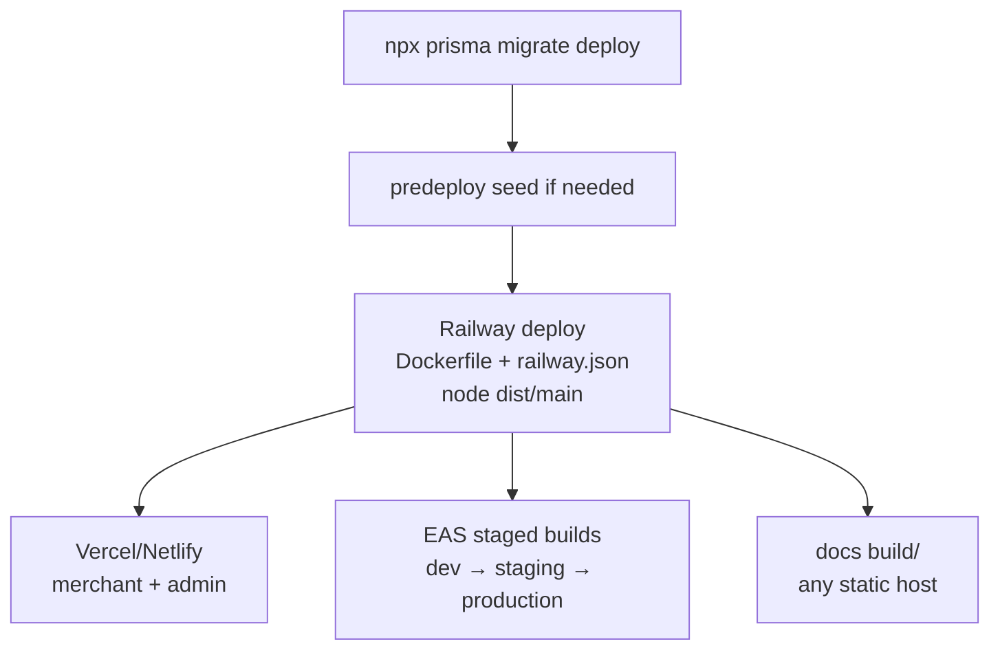

# Deployment

Ship in this order: **database → backend → web → mobile → docs**.

| Step | Command / action | Verify |
|---|---|---|
| Migrate | `npx prisma migrate deploy` | Migration log clean, `Backup` exists |
| Backend | Push → Railway (`predeploy`: `migrate deploy && seed`) | `/api/v1/health`, `/api/docs` |
| Merchant/Admin | Vercel/Netlify (`npm run build` → `dist/`) | Login + one write flow, CORS clean |
| Mobile | `scripts/run-eas.mjs build --profile <env>` | Install on device, live catalog renders |
| Docs | `npm run build` → `build/` → host | `npm run serve` sanity check first |

:::warning Mobile base URL
`src/network/constants.ts` must point at the deployed backend **before** the
EAS build. A staging app baked with the prod URL (or vice versa) tests the
wrong backend silently.
:::
