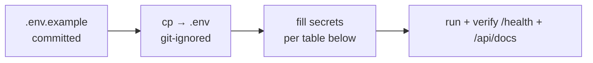

# Environment config

Copy the example, never commit the real file.

## Backend (`DUKA-BACKEND/.env`)

| Var | Purpose |
|---|---|
| `DATABASE_URL` | Postgres 16 connection (Prisma) |
| `REDIS_URL` (or `REDIS_HOST/PORT`) | Cache/OTP/queues (no fallback in staging) |
| `JWT_*` (secret/expiry) | Token issue/verify — rotation revokes sessions |
| `CORS_ORIGINS` | Allowlist + built-in `*.netlify.app`, `*.railway.app`, localhost |
| `STORAGE_PROVIDER/BUCKET/REGION/ENDPOINT/ACCESS_KEY/SECRET_KEY` | S3-compatible media |
| `GOOGLE_*/APPLE_*` | OAuth verify |
| Payment/mail/push keys | Paystack/Flutterwave/Stripe, sendgrid/resend/ses/smtp, FCM |
| `PORT` | default `4000` |

## Clients

| Project | File | Keys |
|---|---|---|
| Merchant (`dukaDesk`) | `.env` | `VITE_API_URL` → `http://localhost:4000/api/v1` locally |
| Admin | `.env` (from `.env.example`) | API base + auth keys (mirror example) |
| Mobile | `app.config.js` + `src/network/constants.ts` | Base URL (Railway prod pinned; LAN IP for local device), Google client IDs, EAS project |
| Docs | none needed | Pure static; only `url` in `docusaurus.config.js` at deploy |

:::danger `.env` hygiene
`.env`, `dukadesk-*.json` (service accounts), `.jks` keystores are secrets.
If one leaks into git, rotate it — don't just delete the commit.
:::
