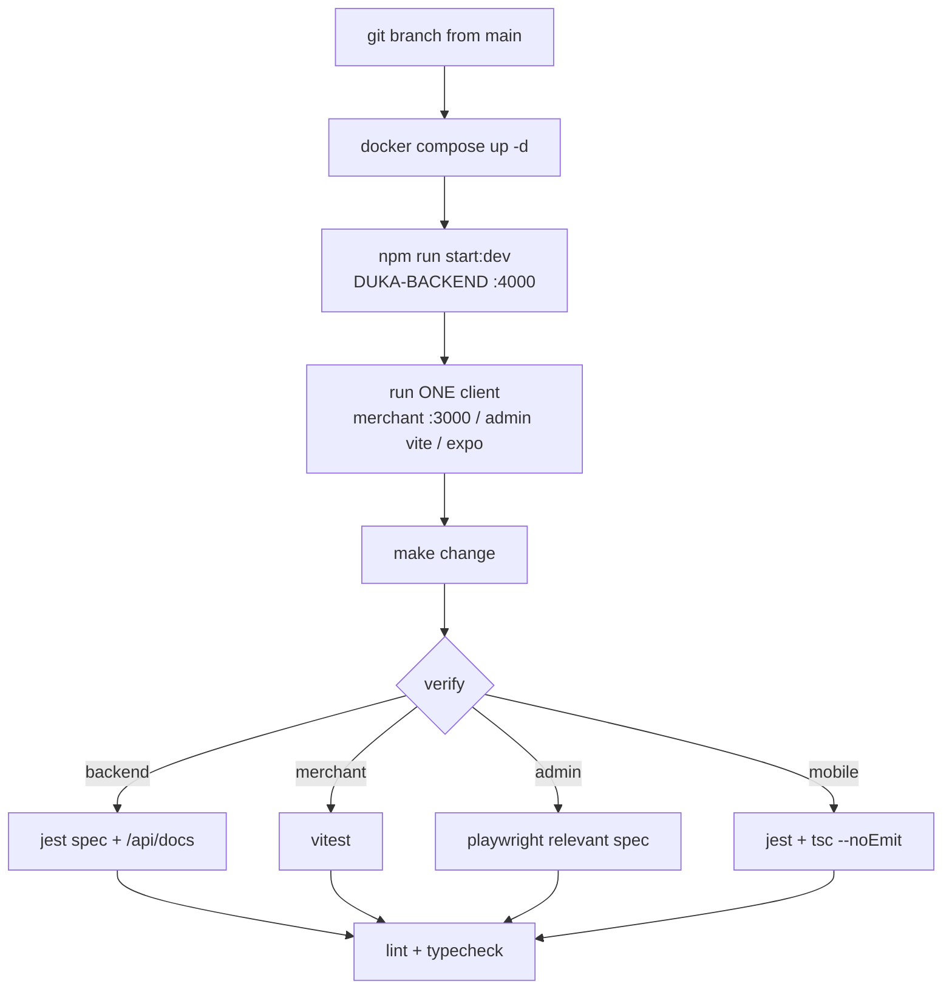

# Local development

## Per-project loop

| Project | Run | Lint/type | Test |
|---|---|---|---|
| Backend | `npm run start:dev` | `npm run lint` | `npm test`, `npm run test:e2e` |
| Merchant | `npm run dev` (`dukaDesk/`) | eslint+prettier | `vitest` |
| Admin | `npm run dev` | `npm run lint` | `npx playwright test` |
| Mobile | `npx expo start` | `npm run lint`, `npx tsc --noEmit` | `npx jest` |
| Docs | `npm start` (`-- --port 3001` if clash) | — | `npm run build` (link check) |

:::tip One client at a time
Backend + one client is the default loop. Running merchant + admin + Expo
simultaneously wastes ports and confuses CORS/OTP state.
:::
