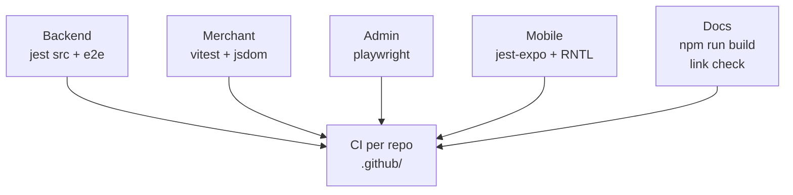

# Testing

| Project | Command | Scope |
|---|---|---|
| Backend | `npm test` / `test:watch` / `test:cov` | `src/**/*.spec.ts` (ts-jest) |
| Backend e2e | `npm run test:e2e` | `test/jest-e2e.json` |
| Merchant | `vitest` (`dukaDesk`) | Component/unit (Testing Library/jsdom) |
| Admin | `npx playwright test` (+ `--ui`, `--headed`, `--debug`) | E2E portal flows |
| Mobile | `npx jest` | `jest-expo` preset (+ `jest.setup.js`) |
| Docs | `npm run build` | Fails on broken links (`onBrokenLinks: throw`) |

:::note Minimum bar before PR
Backend: touched module spec passes. Web: related test passes. Mobile:
`jest` + `tsc --noEmit` clean. Docs: `npm run build` clean. New API route:
spec + Swagger annotation + one client call verified live.
:::
