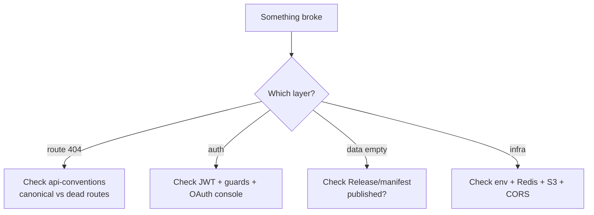

# Troubleshooting

| Symptom | Likely cause | Fix |
|---|---|---|
| `GET /tenants/…` 404 | Wrong prefix | Use `/merchants/{id}` |
| `GET /profile` 404 | Moved | Use `GET /bff/mobile/profile` |
| Empty screens, no error | No published release | Publish from builder; mobile shows "No published …" by design |
| OTP never verifies locally | No `REDIS_URL` (Map fallback per process) | Point at shared Redis |
| Uploads vanish after redeploy | `STORAGE_PROVIDER=local` | Configure S3-compatible storage |
| Portal CORS errors | Preview URL not allowlisted | Add to `CORS_ORIGINS` / redeploy backend |
| OAuth `access_denied` | Redirect/bundle ID unregistered | Register in Google/Apple console + env |
| Webhook double-charge | Non-idempotent handler | Dedupe on provider event ID (`WebhookEvent`) |
| Expo native crash on auth | Static `expo-auth-session` import | Lazy-require inside hook (existing pattern) |
| Docs mermaid blank | Missing theme/plugin | `themes: ['@docusaurus/theme-mermaid']` + `markdown.mermaid: true` + `npm install` |
| Docs build broken link | Bad `to:` / `(...).md` | Fix target; build uses `throw` |
| Port busy `:3000` | Two docs sites | `npm start -- --port 3001` |

